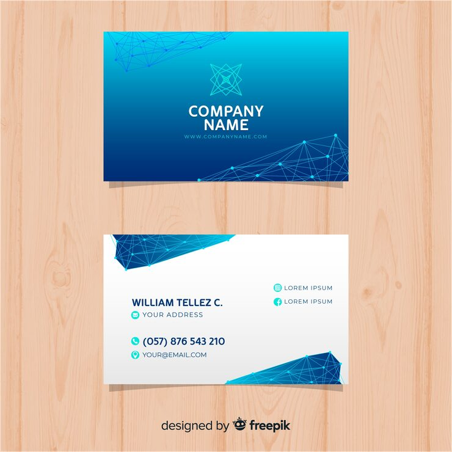

# Blue network-node gradient business card

**Discipline:** branding · **Design type:** Brand application mockups · **Design style:** Corporate & Clean-Tech
**Tags:** business card, network node, blue gradient, tech branding, mockup

## What it is
A two-sided business card mockup with a blue gradient front bearing a triangular network-node emblem and connecting-line texture, and a clean white back with teal contact icons.

## What it means
A geometric node-and-line emblem functions as an instant, ownable logo mark for a company that hasn't specified an industry beyond 'tech,' making the template broadly reusable.

## Techniques
- build an abstract logo mark from connected dots/lines evoking a data network
- split card sides between a bold gradient face and a clean white informational back
- use small filled circular icon badges for contact details on the white side for consistency

## Best for
- tech startup stationery
- professional network/consulting branding
- clean corporate identity systems

## Vocabulary
- **node network mark** — a logo or graphic motif made of connected points and lines suggesting networking, data or connectivity
