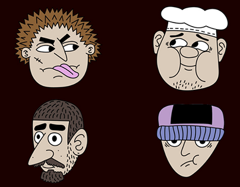

# Four cartoon character heads with exaggerated expressions on dark maroon

**Discipline:** branding · **Design type:** Mascot illustration · **Design style:** Playful & Illustrated
**Tags:** character-design, cartoon, faces, expressions, illustration, maroon

## What it is
Four flat cartoon heads on dark maroon with thick black outlines: a spiky-haired scarred guy sticking out his tongue, a worried chef in a hat, a big-nosed bearded man, and a sulky face under a purple beanie.

## What it means
Humorous and characterful; exaggerated features give each face a personality instantly.

## Techniques
- Exaggerate one feature per character.
- Use consistent line weight across a cast.
- Keep a muted skin palette and one accent per head.

## Best for
- Mascot casts
- Stickers and emoji sets
- Animation character sheets

## Vocabulary
- **Character sheet** — A set showing characters' designs together.
- **Exaggeration** — Enlarging features to express personality.
