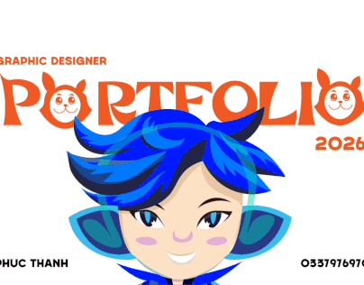

# Portfolio cover with orange display letters, cat-ear Os and an illustrated avatar

**Discipline:** branding · **Design type:** Portfolio cover
**Tags:** portfolio, cover, orange, illustration, mascot, display-type, blue-hair, character

## What it is
A white cover where the word PORTFOLIO is set in chunky orange letters with the two O's turned into cat-faced characters. Above is 'Graphic designer', with '2026' at the right. Below a cropped blue-haired illustrated avatar with big eyes fills the centre, and name and phone sit at the base.

## What it means
Bright, cute and confident; the character makes the designer memorable.

## Techniques
- Turn letters (the O) into characters.
- Pair chunky orange type with a blue-haired illustration for complementary colour.
- Crop the avatar so it appears to peek into the frame.
- Use tiny captions at the corners.

## Best for
- Illustrator and designer covers
- Youthful personal brands
- Character-led portfolios

## Vocabulary
- **Letter character** — A letter redrawn as a face or creature.
- **Complementary pair** — Blue and orange used together for contrast.
- **Peek crop** — A character partially cut by the frame.
- **Avatar illustration** — A drawn self-portrait.
