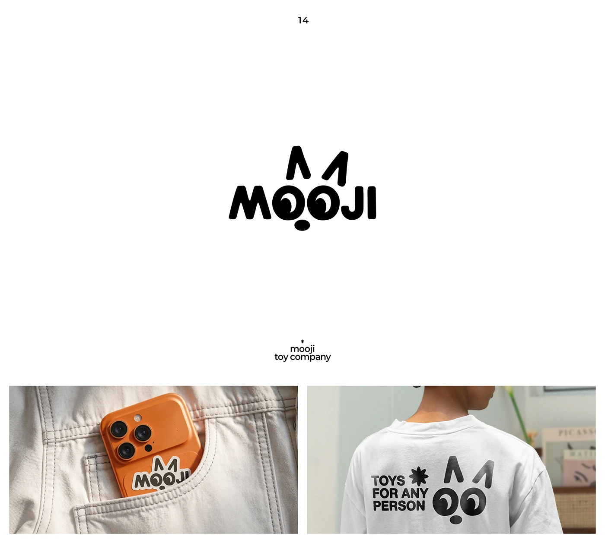

# Rounded MOOJI wordmark whose Os are eyes and ears rise above, shown as a phone sticker and a tee print

**Discipline:** branding · **Design type:** Wordmarks
**Tags:** wordmark, character, cat, black-and-white, rounded, toy, sticker, apparel

## What it is
A white slide with corner captions and a black rounded wordmark 'MOOJI' in which the two Os are round eyes with pupils, a small nose blob below and two angled strokes above as ears, then two photos: the mark as a die-cut sticker on an orange phone in a jeans pocket, and the eyes and ears printed on the back of a white tee with 'TOYS FOR ANY PERSON'.

## What it means
Cute and cheeky; the wordmark turns into a face, perfect for toys.

## Techniques
- Turn letters into eyes and add ears and a nose.
- Use a fat rounded typeface.
- Apply as a die-cut sticker.
- Print the face on the back of a tee.

## Best for
- Toy and kids' brands
- Character wordmarks
- Sticker and apparel merch

## Vocabulary
- **Letter-face** — Letters arranged to form a face.
- **Character wordmark** — A logo that doubles as a mascot.
- **Die-cut sticker** — A sticker cut to the outline of the art.
- **Back print** — A graphic printed on the back of a shirt.
