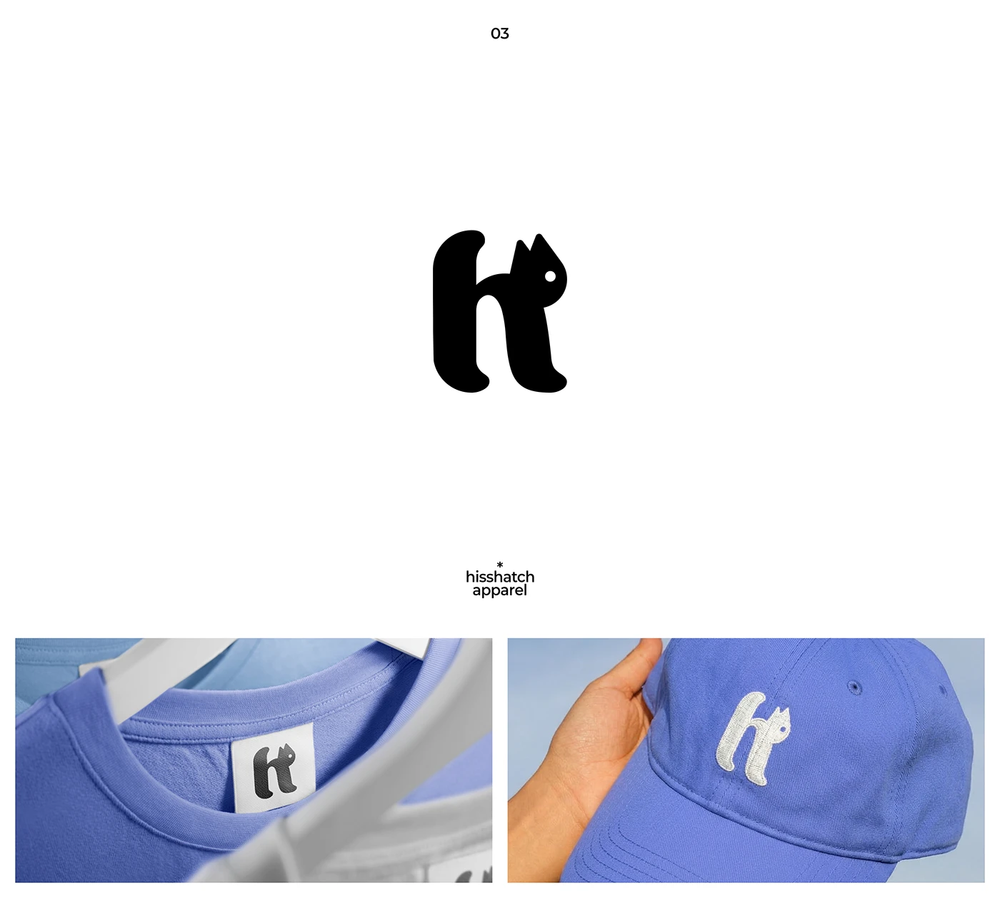

# Rounded h letter with a cat head peeking from its arch, on a woven tee label and a periwinkle cap

**Discipline:** branding · **Design type:** Logo with symbol
**Tags:** logo, monogram, cat, apparel, woven-label, embroidery, periwinkle, hidden-animal

## What it is
A white slide with a fat black lowercase h whose shoulder becomes a cat with pointed ears and a white eye, captioned 'hisshatch apparel', and two photos: the mark on a woven neck label in a periwinkle tee and embroidered in white on a matching cap.

## What it means
Cute and witty; the cat hides in the letter, and periwinkle merch feels fresh.

## Techniques
- Hide an animal inside a letter's counter shape.
- Use one white eye dot as the only detail.
- Apply as woven label and embroidery.
- Match all merch to one periwinkle.

## Best for
- Apparel and streetwear brands
- Playful monograms
- Merch systems

## Vocabulary
- **Hidden animal** — An animal concealed in a letterform.
- **Woven label** — A stitched fabric tag.
- **Embroidered mark** — A logo stitched onto a garment.
- **Eye dot** — A single dot creating a face.
