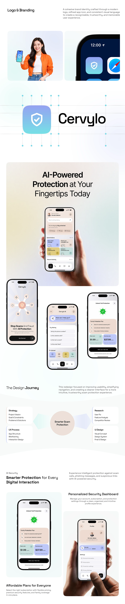

# Shield Logo and Product Long Sheet

**Discipline:** branding ·  · **Design style:** Corporate & Clean-Tech
**Tags:** logo, shield, pastel, long-scroll, design-journey, phones, grid-lines, teal

## What it is
A very tall pale sheet: a Logo & Branding heading, a woman with a phone and a phone corner with the icon, a shield app icon beside a large wordmark on a dotted construction grid, a hero of a hand-held phone, phones fanned below, a Design Journey diagram with a centre badge and four labelled boxes, and feature and pricing screens.

## What it means
Moving from logo through product to process in one long sheet tells a full brand story in a soft teal and peach palette.

## Techniques
- Logo shown with a dotted construction grid
- Icon and wordmark lockup at large scale
- Hand-held phone as a hero photo
- Design Journey diagram with a centre badge
- Alternating text and device sections

## Best for
- Logo plus product case studies
- Security and safety brands
- Long identity-and-app sheets

## Vocabulary
- **Construction dots** — Dotted guide points marking a logo's geometry.
- **Design journey** — A diagram of the phases used to design a product.
- **Lockup** — A fixed arrangement of icon and wordmark.
