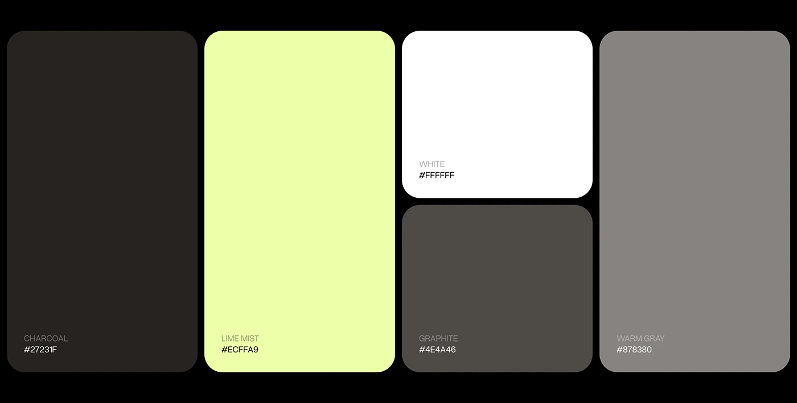

# Charcoal, Lime Mist and Warm Gray Palette

**Discipline:** branding · **Design type:** Colour palette
**Tags:** palette, charcoal, lime, gray, white, rounded, black-background

## What it is
Five rounded colour cards on black: tall Charcoal, tall pale Lime Mist, a white card over a Graphite card, and a tall Warm Gray, each labelled with a name and hex code.

## What it means
A palette of warm neutrals with one pale acid lime feels calm, natural and modern. The uneven card heights add rhythm.

## Techniques
- Cards of different heights arranged in a bento
- Names with hex codes in the bottom-left corner
- Pale lime used as the single accent against dark neutrals
- Warm rather than cool greys
- Big corner radius across the set

## Best for
- Brand colour documentation
- Smart-home, wellness and tech identities
- Palette slides in presentations

## Vocabulary
- **Swatch card** — A colour block with its name and code.
- **Warm gray** — A grey with a slight brown or yellow undertone.
- **Accent neutral** — A very pale colour that behaves almost like a neutral.
