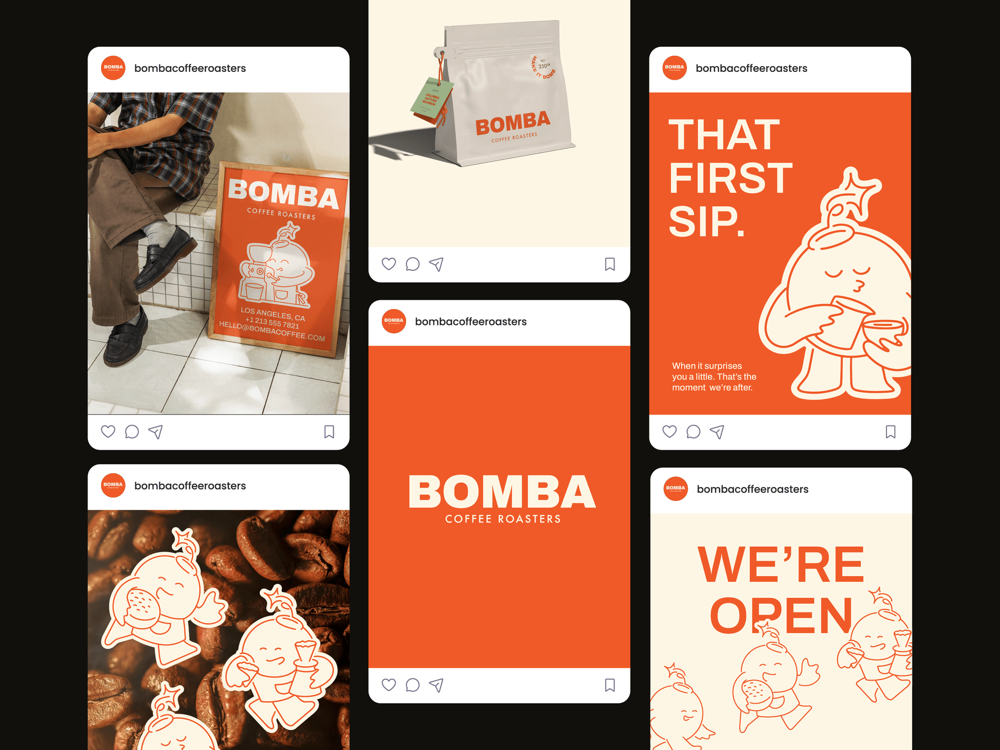

# Orange and cream coffee-roaster identity across Instagram-style cards: poster in a photo, pouch, wordmark panel and outline mascot

**Discipline:** branding ·  · **Design style:** Playful & Illustrated
**Tags:** coffee, orange, cream, mascot, line-illustration, instagram, packaging, poster

## What it is
A black board with six Instagram-style cards: a photo of a person on white tiles beside an orange framed poster with a mascot and contact info, a cream pouch with 'BOMBA' and a tag, a full orange card with a big cream wordmark, an orange card 'THAT FIRST SIP.' with a large outline mascot, coffee beans with sticker-like mascots and a cream card 'WE'RE OPEN' with mascots.

## What it means
Warm and friendly; an outline mascot on orange makes a coffee brand instantly recognisable.

## Techniques
- Draw a mascot in cream outline on orange.
- Use big cream wordmarks on flat orange.
- Give the mascot sticker outlines over photos.
- Present as Instagram-post frames.

## Best for
- Coffee and food brand identities
- Mascot-led social systems
- Orange and cream palettes

## Vocabulary
- **Outline mascot** — A character drawn in a single-colour outline.
- **Sticker outline** — A thick border making an illustration look like a sticker.
- **Colour panel post** — A post filled with one brand colour.
- **Post frames** — Cards shaped like Instagram posts.
