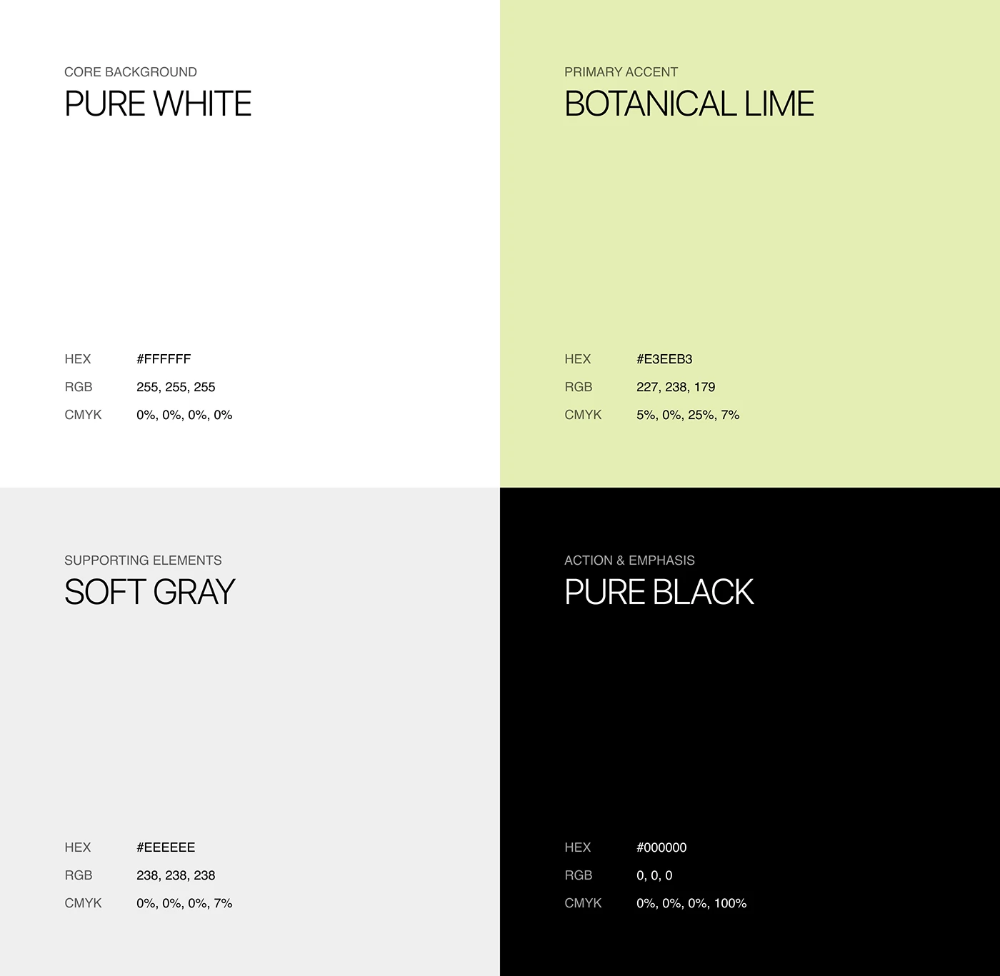

# Four-quadrant palette: white, botanical lime, soft grey, black

**Discipline:** branding · **Design type:** Colour palette
**Tags:** colour-palette, brand-guidelines, lime, monochrome, specs, quadrants

## What it is
A 2x2 grid of full-bleed colour blocks. Each names a role (core background, primary accent, supporting elements, action and emphasis) with big light type and HEX, RGB, CMYK values.

## What it means
Confident and systematic; one pale lime is the only colour, so it carries the whole brand.

## Techniques
- Give every colour a job title, not just a name.
- Present palettes as huge blocks so proportions are felt.
- List colour values in a clean three-row spec.
- Keep three neutrals and one accent to make the accent unmistakable.

## Best for
- Brand guidelines
- Design system documentation
- Neutral-plus-accent identities

## Vocabulary
- **Colour role** — The function assigned to a colour (background, accent, action).
- **Accent colour** — The one distinctive hue in a mostly neutral palette.
- **Colour spec** — HEX, RGB and CMYK values for a colour.
- **Full-bleed block** — A colour area extending to the edge.
