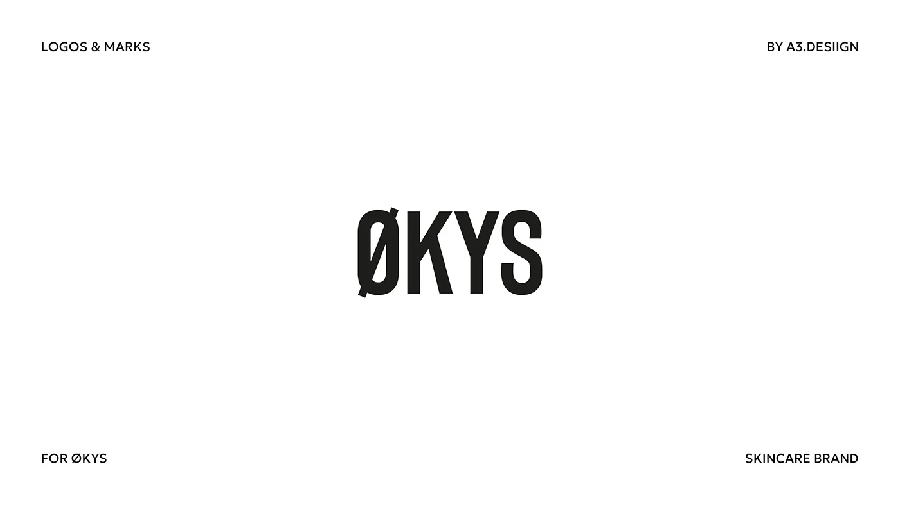

# Condensed bold wordmark with slashed O for a skincare brand

**Discipline:** branding ·  · **Design style:** Minimalist
**Tags:** wordmark, condensed-sans, slashed-o, black-and-white, minimal, skincare, corner-labels

## What it is
A white presentation slide with a black condensed wordmark 'ØKYS' in the centre and four tiny caps labels at the corners (logos and marks, designer credit, brand, category).

## What it means
Strong, clinical and modern; the slashed O adds a Nordic twist and a distinctive detail.

## Techniques
- Use a tall condensed sans for a strong, stable shape.
- Replace one letter with a diacritic (Ø) as the single ownable detail.
- Place small caption labels in the four corners as a frame.
- Keep pure black on white with lots of empty space.

## Best for
- Skincare and wellness brands
- Minimal typographic identities
- Logo presentation slides

## Vocabulary
- **Condensed sans** — A narrow sans-serif with tall proportions.
- **Slashed O** — An O with a diagonal stroke through it.
- **Corner labels** — Small text in the four corners of a slide.
- **Ownable detail** — A distinctive feature that makes a wordmark unique.
