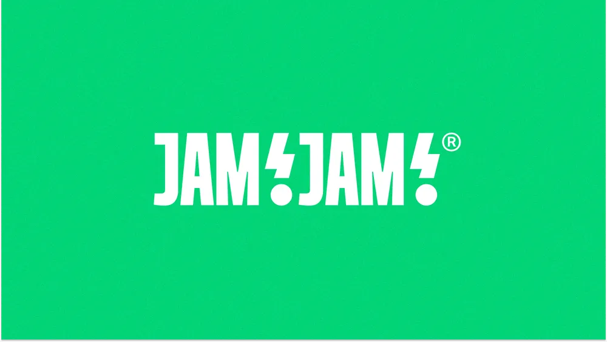

# Bold condensed white 'JAM!JAM!' wordmark with lightning-bolt separators and dotted exclamation marks on spotify-green

**Discipline:** branding ·  · **Design style:** Corporate & Clean-Tech
**Tags:** wordmark, condensed, white, green, lightning, exclamation, music, registered

## What it is
A saturated green field with a white heavy condensed wordmark 'JAM!JAM!' where each exclamation mark is a bolt over a round dot, followed by a ® mark.

## What it means
Loud and electric; exclamation bolts make the name shout.

## Techniques
- Turn exclamation marks into lightning bolts.
- Use heavy condensed capitals.
- Keep white on a single green.
- Repeat the name for rhythm.

## Best for
- Music and event brands
- Energy-driven wordmarks
- Single-colour logos

## Vocabulary
- **Bolt punctuation** — Punctuation drawn as a lightning bolt.
- **Condensed caps** — Tall narrow uppercase letters.
- **Repeated name** — A name said twice as a wordmark.
- **Reversed logo** — A logo in white on colour.
