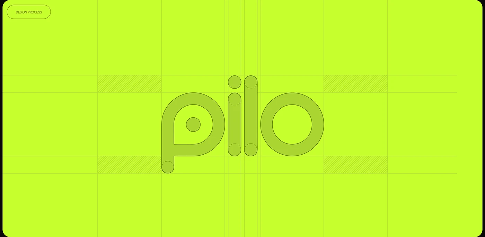

# Rounded 'pilo' wordmark shown as darker lime shapes on electric lime with grid guides and dotted circles

**Discipline:** branding · **Design type:** Logo guidelines
**Tags:** logo, construction, lime, rounded, grid, guides, wordmark, monoline

## What it is
An electric lime board with a thin outlined pill 'Design Process', a grid of faint guide lines with hatched rectangles, and a wordmark 'pilo' in darker lime made of rounded strokes and circles with dotted construction circles at the ends and a dot in the p.

## What it means
Precise and playful; tone-on-tone shows the wordmark's geometry.

## Techniques
- Show the wordmark tone-on-tone.
- Overlay grid guides and dotted circles.
- Build letters from circles and pill strokes.
- Add hatched spacing boxes.

## Best for
- Logo construction pages
- Rounded geometric wordmarks
- Neon-lime identities

## Vocabulary
- **Construction guides** — Lines showing how a logo is built.
- **Dotted circle** — A dotted outline marking a curve.
- **Hatched spacer** — A striped box showing spacing.
- **Tone-on-tone** — Two close shades of one hue.
