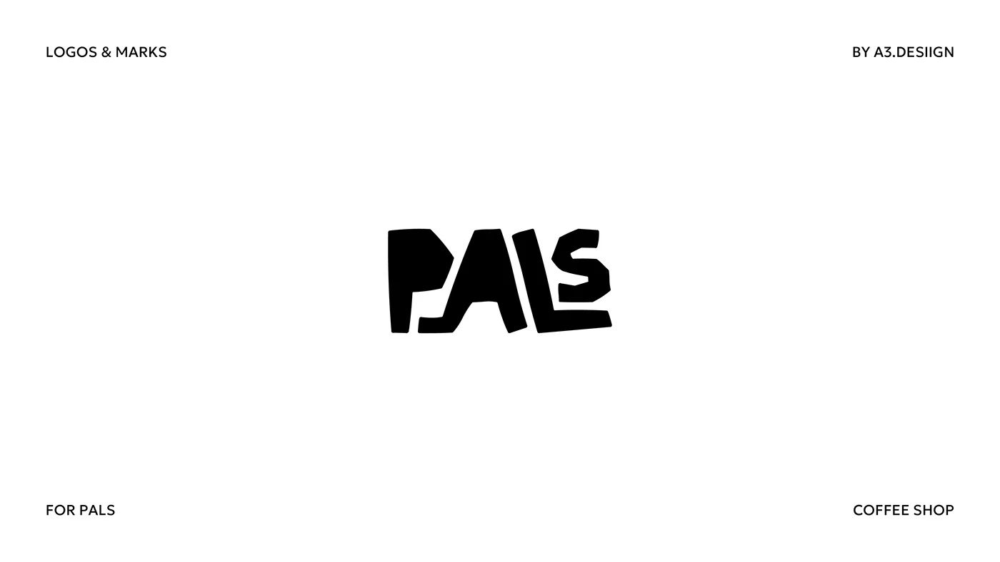

# Chunky cut-paper style PALS wordmark with irregular letters and a tight lockup

**Discipline:** branding ·  · **Design style:** Warm & Organic
**Tags:** wordmark, cut-paper, hand-cut, black-and-white, coffee, irregular, corner-labels, playful

## What it is
A white slide with tiny corner captions and a black wordmark 'PALS' whose letters look hand-cut from paper, uneven and tightly interlocked so the P, A, L and S share edges.

## What it means
Friendly and imperfect, like a neighbourhood coffee shop drawn by a friend.

## Techniques
- Cut letters with slightly irregular edges as if from paper.
- Interlock letters so they share contours.
- Keep the mark solid black.
- Place tiny caps labels in the corners.

## Best for
- Cafés and hospitality
- Community and craft brands
- Playful one-colour logos

## Vocabulary
- **Cut-paper lettering** — Letters that mimic scissor-cut edges.
- **Interlocked letters** — Letters that share edges or overlap.
- **Hand-cut feel** — A slightly uneven, handmade look.
- **Corner captions** — Small labels in the corners of a slide.
