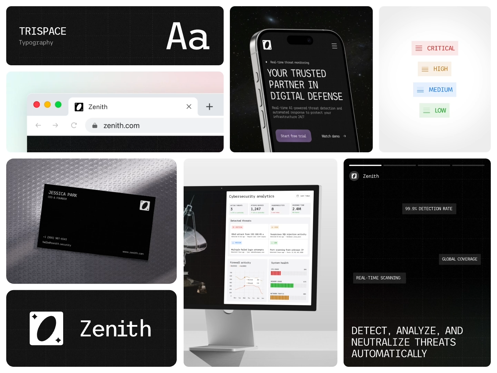

# Dark Cybersecurity Identity Board

**Discipline:** branding ·  · **Design style:** Neo-Brutalist
**Tags:** dark, monospace, tech, security, board, mockups, grid, business-card

## What it is
A bento-grid brand presentation for a security company: monospace typography specimen 'Aa', browser tab, phone hero, severity color chips, embossed black business card, dashboard on a monitor beside a satellite dish, a black logo tile with a slashed oval mark and a story-format slide.

## What it means
Black surfaces, monospace type and a single abstract oval mark feel precise and vigilant. The mixed mockups prove the identity works across product and print.

## Techniques
- Bento grid of unequal tiles combining logo, type, color, mockups
- Monospace typeface as the identity's core voice
- Severity chips (critical, high, medium, low) as a functional color system
- Embossed dot texture on the business card surface
- Faint grid lines behind dark tiles for a technical feel

## Best for
- Tech, security and infrastructure brands
- Identity case-study presentations
- Systems that must span UI and marketing

## Vocabulary
- **Bento board** — A grid of differently sized tiles presenting a brand's assets.
- **Type specimen tile** — A tile showing the typeface with 'Aa' and a name.
- **Functional palette** — Colors assigned to meanings rather than only aesthetics.
