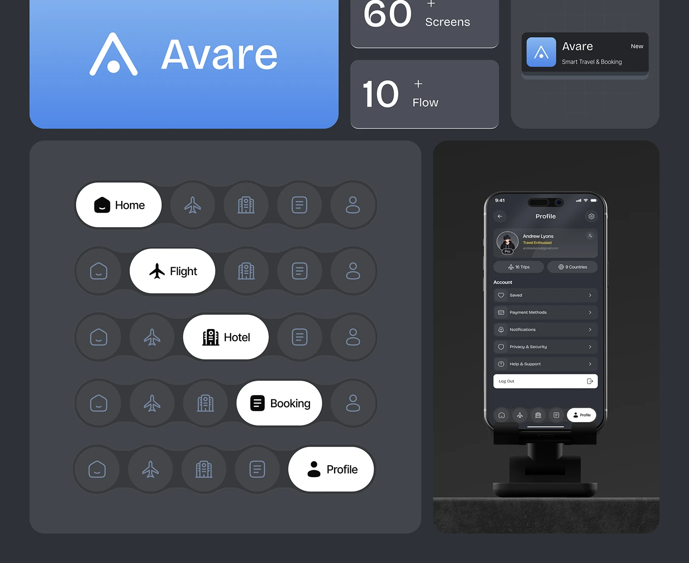

# Dark Brand Tiles with Nav Pill States

**Discipline:** branding · **Design type:** Brand identity board
**Tags:** brand-board, dark, blue, nav-pills, stat-tiles, logo, notification, bento

## What it is
A dark slate bento cropped at the top: a blue gradient tile with a white wordmark and triangle mark, stat tiles (60+ Screens, 10+ Flow), a notification card with the app icon, five rows of pill navigation showing each tab active in white, and a phone on a rock ledge showing a profile screen.

## What it means
Showing each nav state in a row demonstrates the system, and a single blue tile anchors the dark board.

## Techniques
- Nav bar shown five times with a moving white pill
- Blue gradient logo tile as the colour anchor
- Stat tiles with large numerals
- Notification card as a brand touchpoint
- Phone on a dark ledge for atmosphere

## Best for
- Brand and UI identity boards
- Navigation state showcases
- Dark bento presentations

## Vocabulary
- **Active pill** — A white rounded shape marking the selected tab.
- **Stat tile** — A tile with a big number and a label.
- **Touchpoint card** — A card imitating a real place the brand appears.
