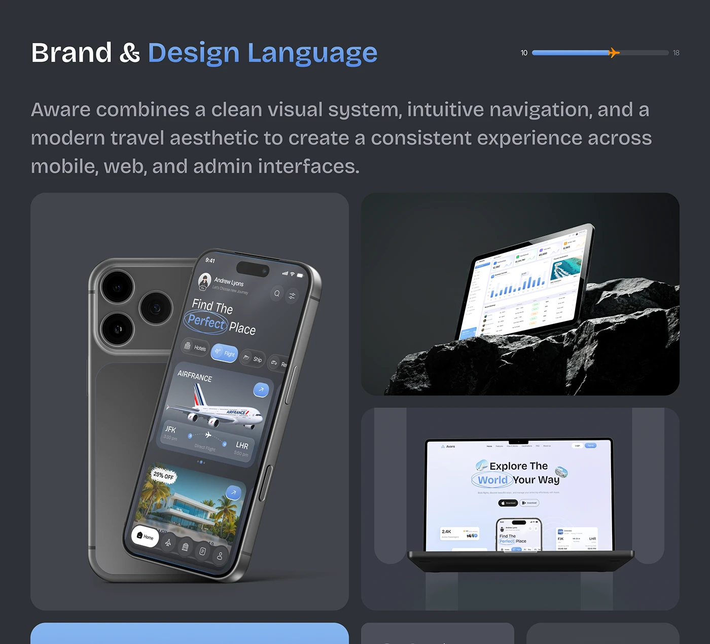

# Dark Design Language Multi-Device Board

**Discipline:** branding · **Design type:** Brand application mockups
**Tags:** design-language, dark, devices, rock, blue, progress-bar, tiles

## What it is
A dark slate page titled Brand & Design Language with a plane progress bar, a paragraph, a tile of a phone with a camera back, a tablet on a black rock with a dashboard and a laptop with a light landing page, and coloured tiles peeking below.

## What it means
Showing phone, tablet and laptop together proves one visual system across devices, and the dark base makes the light UIs stand out.

## Techniques
- Three devices in three different tiles
- Rock as a natural base for the tablet
- Blue highlight on the word Design Language
- Plane marker on the progress bar
- Tiles in a bento layout

## Best for
- Multi-platform design language slides
- Brand consistency showcases
- Dark case-study documentation

## Vocabulary
- **Design language** — The visual and interaction rules that make a product feel consistent.
- **Multi-device tile** — A tile showing the design on one device type.
- **Progress bar** — A bar showing position within a document.
