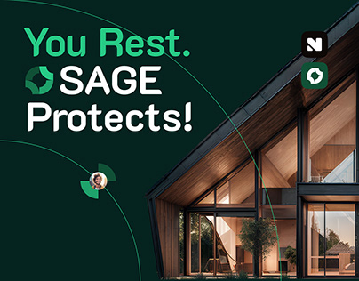

# Sage Protects Cover with Timber House

**Discipline:** branding · **Design type:** Brand campaign cover
**Tags:** dark-green, mint, headline, house, logo, circle-lines, security

## What it is
A dark green cover with a mint-and-white headline 'You Rest. SAGE Protects!' with the brand mark inline, thin mint circle lines, an avatar node, two logo tiles and a dusk photograph of a timber house with glowing windows.

## What it means
The warm lit house against deep green says safety and home at night, and mint type keeps it crisp.

## Techniques
- Inline logo inside the headline
- Thin circle lines as a subtle motif
- Warm lit architecture against deep green
- Mint highlight on the first line
- Logo tiles as corner stamps

## Best for
- Home security and insurance brands
- Campaign covers with a strong headline
- Green and mint identities

## Vocabulary
- **Inline mark** — A logo placed within a line of headline text.
- **Circle line motif** — Thin concentric arcs used as background graphic.
- **Dusk photograph** — A photo taken at twilight with lit windows.
