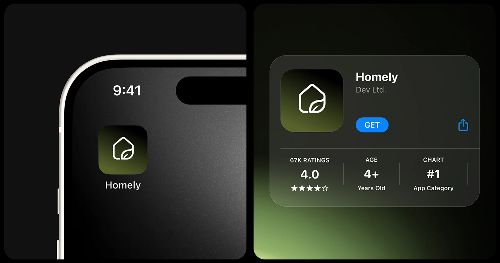

# Olive App Icon Close-Up and Store Card

**Discipline:** branding ·  · **Design style:** Glassmorphism
**Tags:** app-icon, olive, dark, store-card, house-leaf, glass

## What it is
Two dark panels: a phone corner with the olive-gradient house-and-leaf icon labelled Homely, and a frosted store listing with the icon, Get button and ratings, over a green glow.

## What it means
The gradient icon glows on black, and the store card proves it works in a real context.

## Techniques
- Macro phone corner as a framing device
- Olive gradient tile with a white line mark
- Frosted glass store card
- Green glow rising from the corner
- Rating, age and chart stats row

## Best for
- App icon reveals
- Smart-home brand presentations
- Dark premium mockups

## Vocabulary
- **Store listing** — An app-store card with icon, name and rating.
- **Line mark** — A logo drawn with a uniform stroke.
- **Corner glow** — Light emerging from one corner of a frame.
