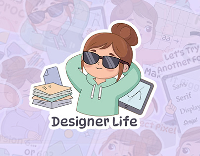

# 'Designer Life' sticker: a chill cartoon girl in sunglasses with papers and a tablet

**Discipline:** branding · **Design type:** Mascot illustration · **Design style:** Playful & Illustrated
**Tags:** stickers, character, designer, cute, hoodie, telegram

## What it is
A sticker of a cartoon girl with a bun, sunglasses and a mint hoodie leaning back with hands behind her head, a stack of papers and a tablet beside her, 'Designer Life' below, over a faded lilac pattern of the sticker pack.

## What it means
Relatable and fun; a designer mascot with attitude speaks to creative in-jokes.

## Techniques
- Give a character one strong pose and prop set.
- Use a thick white sticker border.
- Fade the full pack behind the hero sticker.

## Best for
- Sticker packs
- Designer community merch
- Mascot sets

## Vocabulary
- **Sticker pack** — A set of illustrated stickers for messaging apps.
- **Die-cut border** — A white outline following a sticker's shape.
