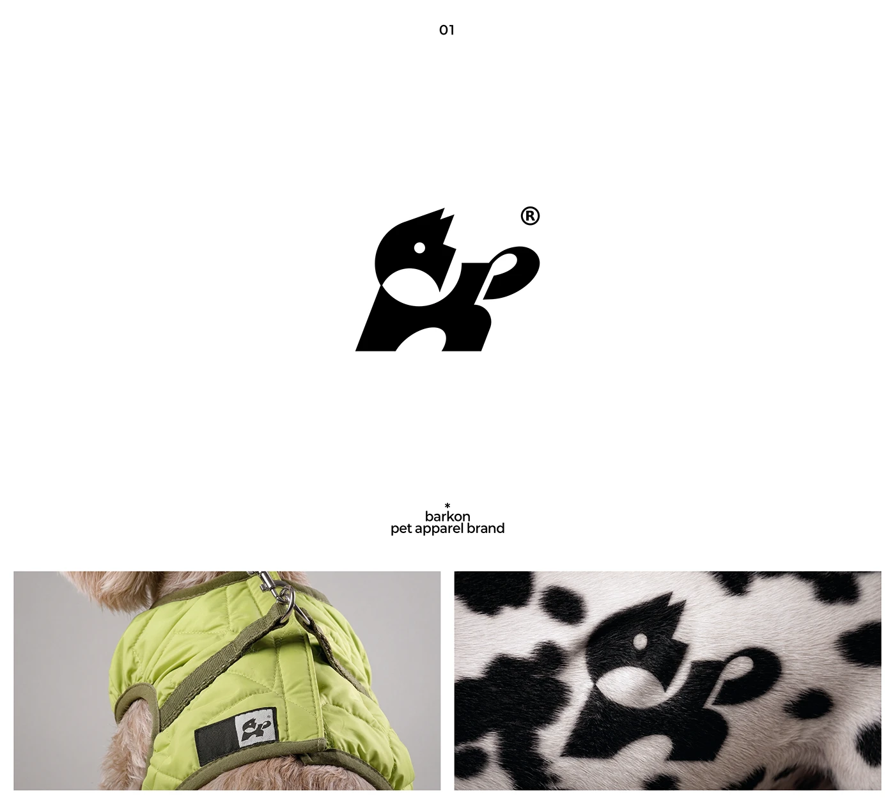

# Dog mark shown on a lime pet jacket label and hidden in Dalmatian fur

**Discipline:** branding · **Design type:** Logo with symbol
**Tags:** logo, pet-apparel, dog, lime, black-and-white, fur-pattern, label, mockup

## What it is
A white slide with the solid dog symbol and ®, below it two photos: a small dog in a quilted lime jacket with a woven tag carrying the mark, and a macro of Dalmatian fur where the black mark blends among the spots.

## What it means
Witty and affectionate; the logo camouflaged in spots shows the brand's cleverness.

## Techniques
- Hide the logo inside a natural pattern.
- Apply a one-colour mark to a small woven tag.
- Use a lime garment as the only colour.
- Show macro texture photography.

## Best for
- Pet apparel and accessories
- Marks that can blend with patterns
- Wovens and label applications

## Vocabulary
- **Camouflaged mark** — A logo hidden inside a pattern.
- **Woven tag** — A fabric label sewn into clothing.
- **Macro texture** — A close-up of material.
- **Single accent colour** — One colour used as the only hue.
