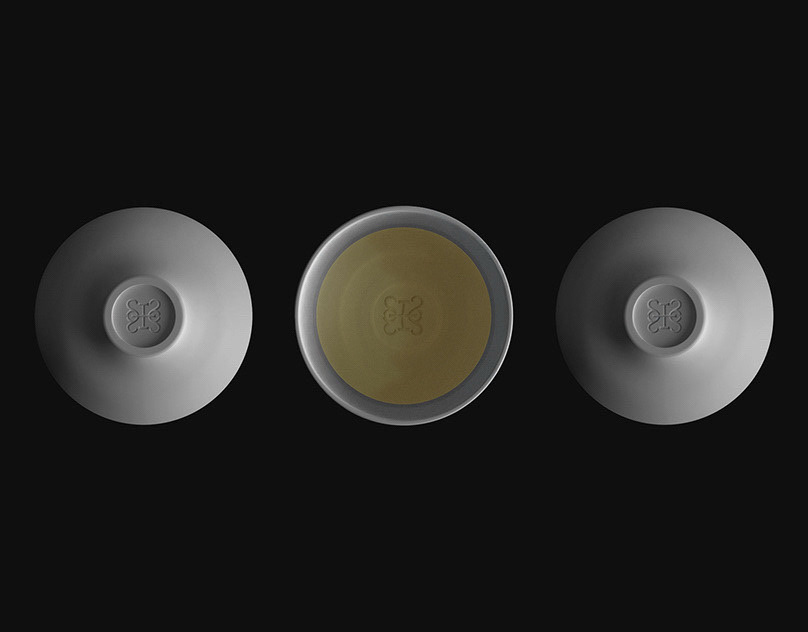

# Three ceramic bowls on black: two upturned showing an embossed monogram, one upright with an olive glaze

**Discipline:** branding · **Design type:** Brand application mockups · **Design style:** Minimalist
**Tags:** ceramics, emboss, monogram, black, product-photo, tableware

## What it is
A top-down photo on pure black of three matte white bowls in a row: the outer two upside down showing a debossed ornamental monogram on the foot, the centre one upright with an olive-gold glazed interior and the same mark pressed in.

## What it means
Quiet luxury; the logo is felt rather than printed, so the brand lives in the material.

## Techniques
- Deboss the logo into the product itself.
- Shoot a symmetrical row on black for drama.
- Break the pattern with one item flipped to reveal colour.

## Best for
- Tableware and ceramics
- Restaurant identities
- Luxury product shots

## Vocabulary
- **Deboss** — Pressing a design into a surface so it sits below it.
- **Foot ring** — The base ring on the underside of a bowl.
