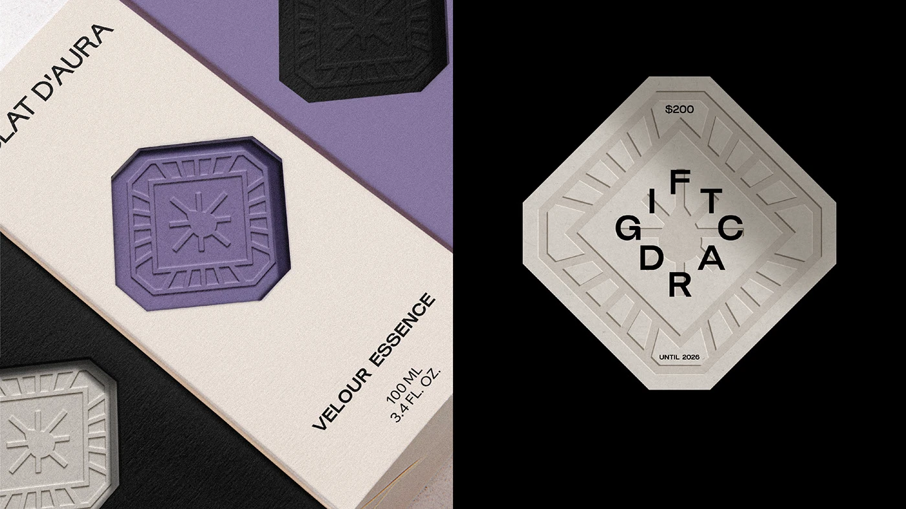

# Blind-embossed crest on cream perfume box and diamond-shaped gift card

**Discipline:** branding · **Design type:** Packaging and print collateral
**Tags:** packaging, perfume, emboss, purple, cream, black, crest, gift-card, tactile

## What it is
A split image. Left, a cream perfume box with diagonal type and an embossed octagonal crest with radiating lines, set on lilac and black stock with matching crests debossed in purple, black and grey. Right, a black background with a diamond-shaped embossed gift card whose letters 'GIFT CARD' are arranged in a cross around the centre.

## What it means
Luxurious and quiet; texture and shadow do the talking, so the brand feels collectable and precious.

## Techniques
- Emboss or deboss a symbol so the mark is felt and lit by shadow.
- Set type at an angle along the box edge for an editorial look.
- Colour-shift the same crest across purple, black and grey stocks.
- Arrange the letters of a phrase into a cross around a central mark.

## Best for
- Fragrance, cosmetics and luxury packaging
- Gift cards and premium stationery
- Brands where tactility matters

## Vocabulary
- **Blind emboss** — A raised design pressed into paper without ink.
- **Deboss** — A design pressed into the surface.
- **Crest** — A heraldic-style emblem.
- **Cross typesetting** — Letters placed in a plus-shaped arrangement.
