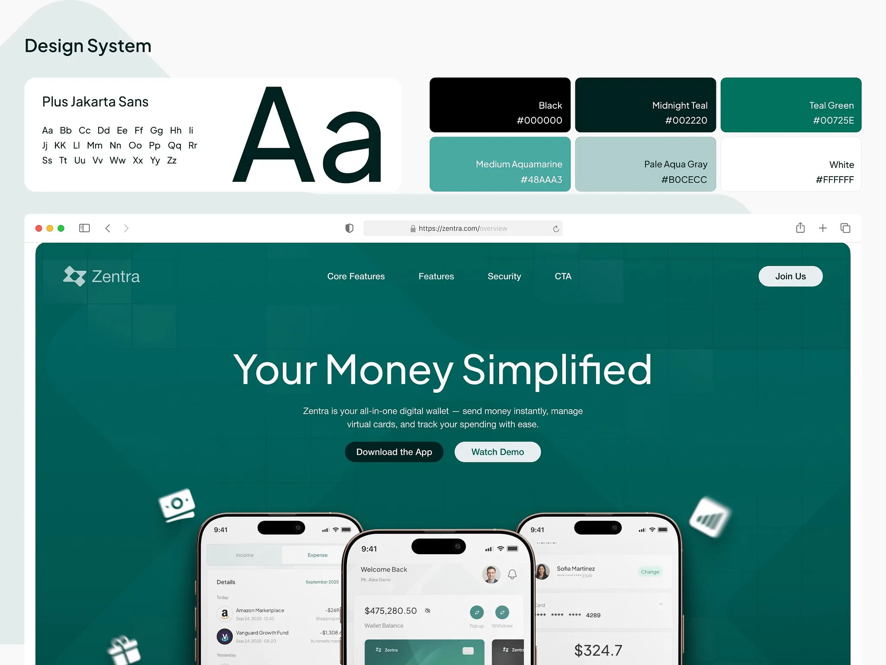

# Design system sheet: type specimen, six teal swatches and a browser hero

**Discipline:** branding · **Design type:** Typography and colour guide
**Tags:** design-system, teal, emerald, typography, palette, browser-mockup, fintech, swatches

## What it is
A pale sheet titled 'Design System' with a card showing Plus Jakarta Sans and a giant Aa, a grid of six named colour swatches with hex codes (black, midnight teal, teal green, medium aquamarine, pale aqua gray, white), and below a browser window with the teal hero 'Your Money Simplified' and three phones.

## What it means
Organised and calm; naming and coding every colour signals a mature system.

## Techniques
- Show type, colour and a live page in one sheet.
- Name each swatch and print its hex value inside it.
- Use a giant Aa as the type moment.
- Frame the applied page in a browser chrome.

## Best for
- Design system overviews
- Fintech brand boards
- Developer handoff pages

## Vocabulary
- **Named swatch** — A colour block labelled with a friendly name and hex code.
- **Giant Aa** — An oversized sample of a typeface.
- **Applied view** — A real page shown next to the system rules.
- **Teal ramp** — A set of tones of teal from dark to pale.
