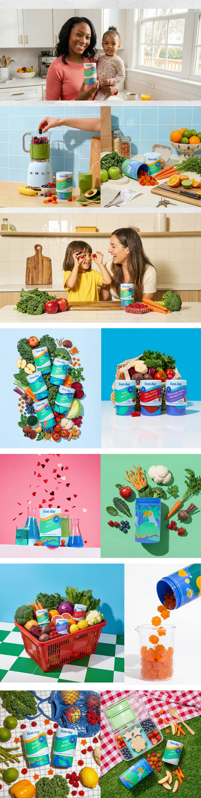

# Family kitchen lifestyle shots and bright colour-block ingredient still lifes with supplement tubs

**Discipline:** branding ·  · **Design style:** Photographic & Cinematic
**Tags:** photography, lifestyle, still-life, supplements, colour-block, kitchen, fruits, family

## What it is
A tall collage of ten photos: a mother and toddler holding a tub in a bright kitchen, a smoothie blend, a child and mother playing with gummies, flat lays of tubs among vegetables on pale blue, a net bag on blue, hearts falling behind lab glass on pink, tubs with produce on green, a red basket on chequered floor, gummies pouring into a beaker and picnic scenes.

## What it means
Warm, fresh and honest; real families and vivid ingredient colour backdrops make health feel joyful.

## Techniques
- Alternate natural kitchen lifestyle photos with graphic colour-block still lifes.
- Style products with the ingredients they contain.
- Use a strong single-colour backdrop per still life.
- Add playful props like falling hearts and lab glass.

## Best for
- Supplement and family-nutrition campaigns
- Packaging launch photography
- Ecommerce hero imagery

## Vocabulary
- **Ingredient styling** — Placing a product with the foods it contains.
- **Colour-block still life** — A product photo on a bold flat colour.
- **Lifestyle shot** — A photo of the product in daily use.
- **Prop story** — Objects chosen to hint at a product idea.
