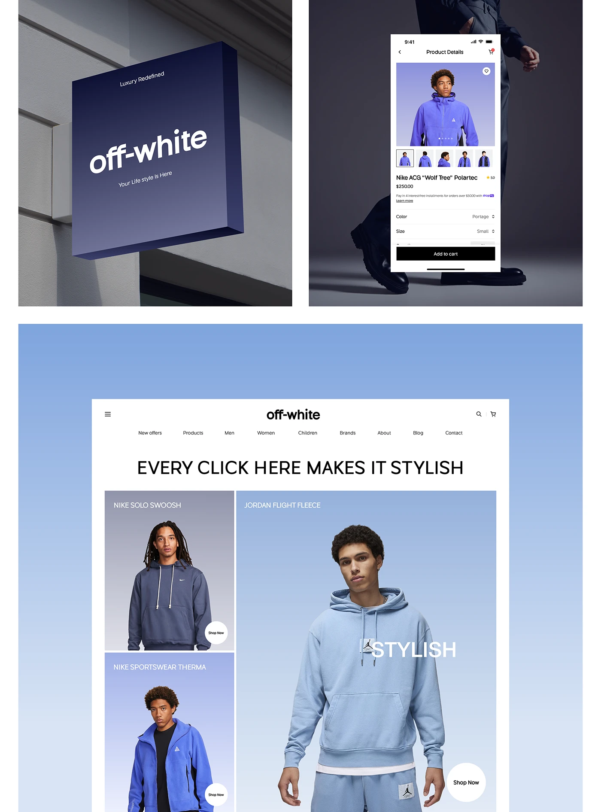

# Blue-violet gradient sign, app screen and web hero for a fashion store

**Discipline:** branding · **Design type:** Brand application mockups
**Tags:** signage, gradient, periwinkle, fashion, mobile, web, wordmark, application

## What it is
A board with a tilted navy-violet gradient wall sign carrying 'off-white' in bold italic white, a phone product page over a dark suited figure, and a blue-gradient web page with 'EVERY CLICK HERE MAKES IT STYLISH' and model tiles.

## What it means
Confident and modern; one blue gradient runs from street signage to screen.

## Techniques
- Use the same gradient on sign, app and web.
- Set the wordmark in italic bold.
- Overlay UI on editorial photography.
- Show physical and digital together.

## Best for
- Retail brand rollouts
- Fashion identity boards
- Cross-channel gradients

## Vocabulary
- **Gradient identity** — A brand built on a signature gradient.
- **Projecting sign** — A wall-mounted sign that sticks out.
- **Italic wordmark** — A logo set in slanted type.
- **Omnichannel board** — A presentation showing physical and digital use.
