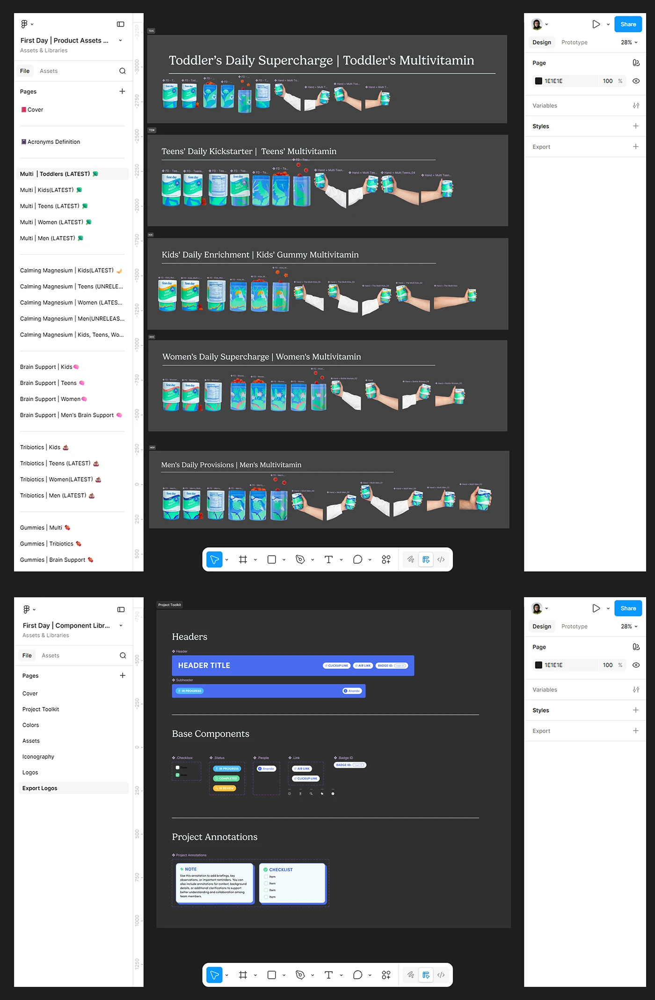

# Figma screens showing product asset rows for kids, teens, women and men, and a component library

**Discipline:** branding ·  · **Design style:** Dark & Neon
**Tags:** figma, assets, packaging, teal, organisation, design-system, dark-ui, components

## What it is
Two dark Figma windows: one with a page list and frames of teal and blue vitamin tubs plus hand-holding shots grouped by audience (toddlers, teens, kids, women, men), and one with a component library page showing headers, status chips, checkboxes and annotation notes in blue.

## What it means
Organised and professional; showing the working file signals a system.

## Techniques
- Group assets by audience in labelled rows.
- Show a page structure sidebar.
- Document components (headers, status, notes) in blue.
- Use the tool's own dark UI as presentation.

## Best for
- Design ops and asset management showcases
- Packaging asset libraries
- Process transparency in case studies

## Vocabulary
- **Asset row** — A row of product images grouped together.
- **Component library** — A file of reusable design elements.
- **Annotation card** — A note component for design comments.
- **Tool screenshot** — A screenshot of design software used as presentation.
