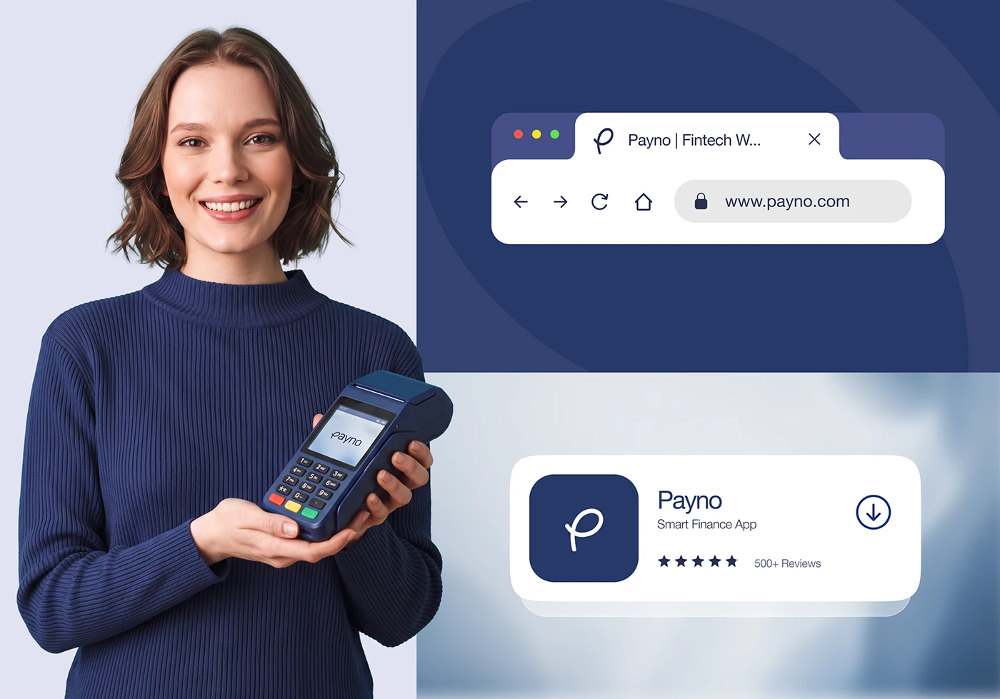

# Navy fintech identity across browser, app store and POS device

**Discipline:** branding · **Design type:** Brand application mockups
**Tags:** fintech, navy, brand-application, mockup, logo-application, payment-terminal, photo-collage, monoline-logo

## What it is
A branding presentation board in deep navy and lilac. A smiling woman in a navy jumper holds a card terminal showing the logo; on the right, a browser tab with the URL bar and an app-store listing card display the handwritten-style 'p' monogram in white on navy.

## What it means
Trustworthy, friendly and human: navy communicates reliability, while the script monogram and smiling photo soften the finance world.

## Techniques
- Show the logo in the small places where people meet it: favicon, URL, app icon, payment screen.
- Match the photo's clothing colour to the brand navy so the person feels part of the identity.
- Split the board into flat colour blocks and cards with rounded corners, so each application sits in its own tidy frame.
- Use a single monoline script 'p' as an icon that works at tiny sizes.
- Layer light card shadows and blurred backdrops for depth without breaking the flat brand palette.

## Best for
- Fintech and payments identity presentations
- Brand rollouts needing to show digital touchpoints
- Startups that want friendly authority

## Vocabulary
- **Touchpoint** — Any place a customer meets a brand, such as an app icon or a terminal.
- **Favicon** — The tiny icon shown in a browser tab.
- **Monogram** — A logo built from one or more initials.
- **Colour echo** — Repeating the brand colour in photography and clothing for cohesion.
