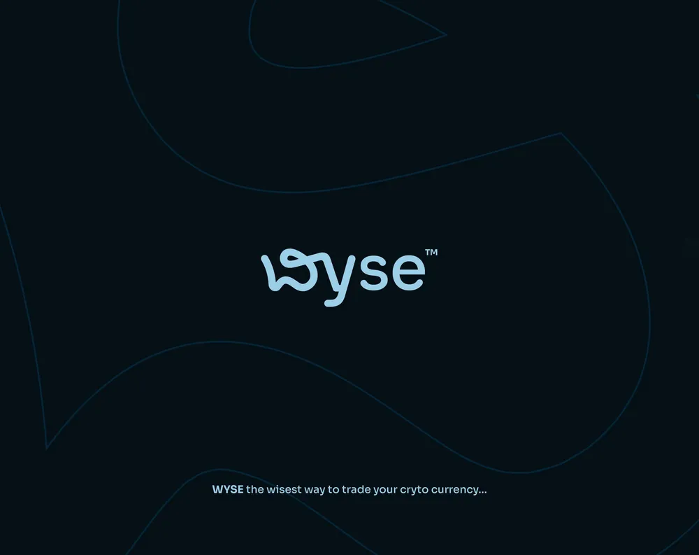

# Fluid Wordmark with Outline Letter Backdrop

**Discipline:** branding ·  · **Design style:** Minimalist
**Tags:** wordmark, fluid, monoline, dark, blue, crypto, outline, tagline

## What it is
A light-blue rounded wordmark 'Wyse' with a looping, wavy W and descender, centered on a deep navy field, with giant faint outline letterforms behind it and a small tagline near the bottom.

## What it means
The flowing W suggests currents and movement (of markets) while soft blue on midnight feels trustworthy and calm. The huge outline shapes add depth without clutter.

## Techniques
- Monoline letters with a distinctive looped W
- Oversized hairline outline of the brand letters as background pattern
- Light-blue on navy low-contrast palette with a single bright element
- Small tagline set well below the mark for hierarchy
- Trademark symbol as small superscript

## Best for
- Crypto, fintech and trading brands
- Modern tech identities that want softness
- Brand reveal slides

## Vocabulary
- **Monoline** — A lettering style with uniform stroke thickness.
- **Ghost letters** — Oversized faint outlines of brand letters used as a background.
- **Ligature loop** — A looping stroke that joins or flourishes a letter.
