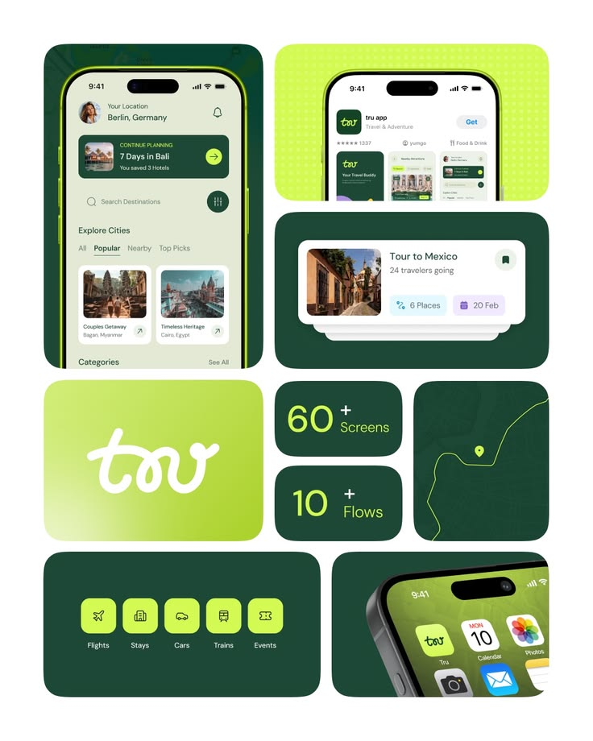

# Forest Green and Lime Travel Brand Bento

**Discipline:** branding ·  · **Design style:** Geometric & Bauhaus
**Tags:** bento, green, lime, travel, logo, script, app-icon, map

## What it is
A bento brand board on white: a lime-rimmed phone with an explore screen, a store listing on dotted lime, a tour card, a lime tile with a white script wordmark, stat tiles (60+ screens, 10+ flows), a contour map line, category icon tiles and an app icon close-up.

## What it means
Forest green and lime feel natural and energetic, and the bento mixes logo, UI and stats to sell completeness.

## Techniques
- Bento tiles of many sizes
- Script wordmark on a lime gradient tile
- Contour-map tile with a glowing route line
- Lime icon tiles on dark green
- Stat tiles with big lime numerals

## Best for
- Travel app brand presentations
- UI kit marketing
- Bento-style identity boards

## Vocabulary
- **Bento board** — A grid of differently sized tiles presenting brand assets.
- **Contour map** — Topographic lines used as a graphic texture.
- **Stat tile** — A tile showing one large number and label.
