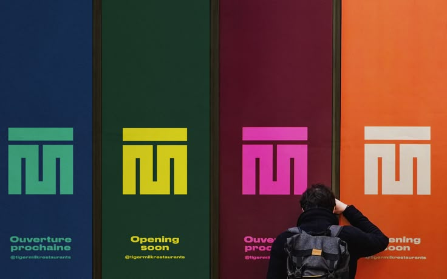

# Four-Colour Maze Monogram Banners

**Discipline:** branding ·  · **Design style:** Playful & Illustrated
**Tags:** monogram, banners, navy, green, magenta, orange, opening-soon, street

## What it is
Four tall street banners in navy, dark green, plum and orange, each carrying the same blocky maze-like monogram in a contrasting colour (mint, yellow, pink, cream) with 'Opening soon' text and a handle, with a passer-by looking on.

## What it means
One simple mark recoloured across vivid grounds shows a flexible, playful identity that still reads as one brand.

## Techniques
- Same mark in four colour pairings
- Bilingual small text at the base
- Person in the scene for scale
- Saturated flat colour fields
- Consistent mark size and position on every banner

## Best for
- Restaurant and hospitality openings
- Flexible colour identity systems
- Outdoor teaser campaigns

## Vocabulary
- **Colour flex** — Recolouring one logo across multiple palette pairs.
- **Teaser banner** — A pre-opening banner showing the mark and a date cue.
- **Monogram block** — A logo built from blocky geometric strokes.
