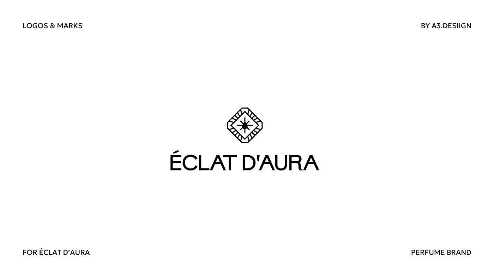

# Octagonal gem outline with radiating star inside, above a wide caps 'ÉCLAT D'AURA' wordmark

**Discipline:** branding · **Design type:** Logo with symbol
**Tags:** logo, emblem, gem, monoline, perfume, black-and-white, luxury, corner-labels

## What it is
A white slide with corner captions and a black monoline symbol of an octagonal cut gemstone with facet lines and a star burst inside, above a wide clean sans wordmark 'ÉCLAT D'AURA'.

## What it means
Precise and radiant; a cut-gem outline with a spark suits a fragrance brand.

## Techniques
- Draw a gem with uniform line weight.
- Add a starburst at its centre.
- Pair with a wide simple sans.
- Keep black on white.

## Best for
- Perfume and jewellery brands
- Monoline emblems
- Luxury minimal logos

## Vocabulary
- **Gem emblem** — A logo built from a cut stone shape.
- **Facet lines** — Lines showing the planes of a gem.
- **Starburst centre** — Rays radiating from the middle.
- **Wide sans wordmark** — A wordmark in extended sans.
