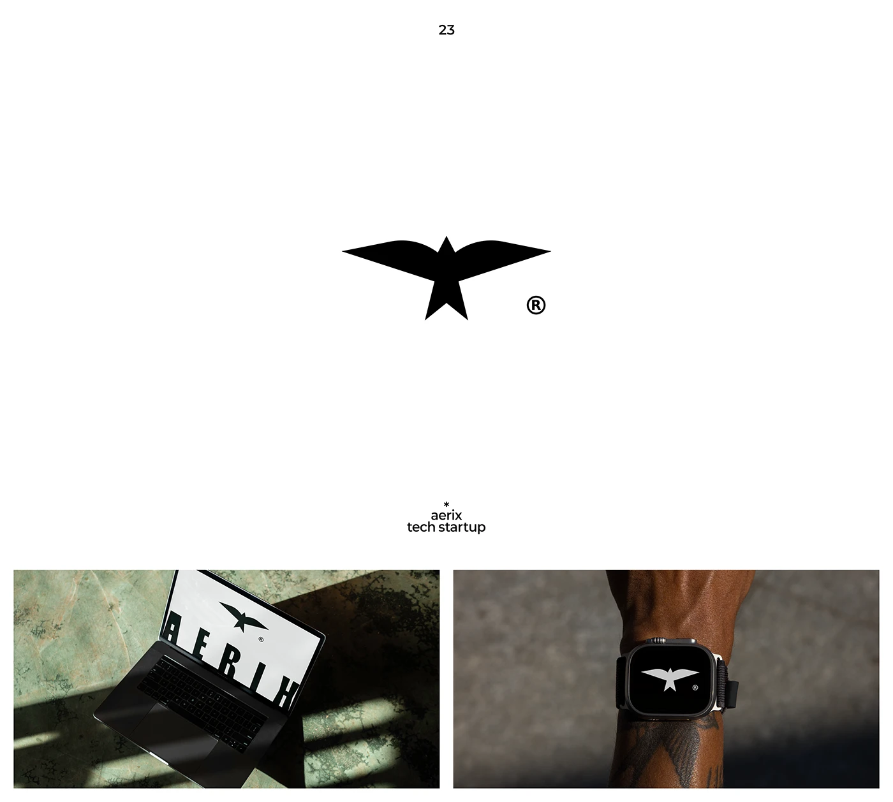

# Solid geometric bird symbol on laptop and smartwatch

**Discipline:** branding ·  · **Design style:** Geometric & Bauhaus
**Tags:** logo, symbol, bird, black, geometric, tech-startup, smartwatch, mockup

## What it is
A white slide with a large solid black bird symbol whose body is a star, then two photographic applications: a laptop in hard sunlight on green stone showing the mark and name, and a smartwatch on a wrist showing the bird in white on black.

## What it means
Bold, swift and precise; the simple silhouette works at watch-face size.

## Techniques
- Reduce an animal to a few geometric planes (wings and a star body).
- Test the symbol on tiny screens such as a watch.
- Photograph mockups with dramatic hard shadows.
- Keep the presentation black-and-white with small caption text.

## Best for
- Tech startup and hardware brands
- Symbols that must work at very small sizes
- Minimal logo presentations

## Vocabulary
- **Silhouette mark** — A solid-colour symbol defined by its outline.
- **Geometric reduction** — Simplifying a form into basic shapes.
- **Small-size test** — Showing a logo at tiny scale.
- **Hard-shadow photo** — A photo with strong sunlight shadows.
