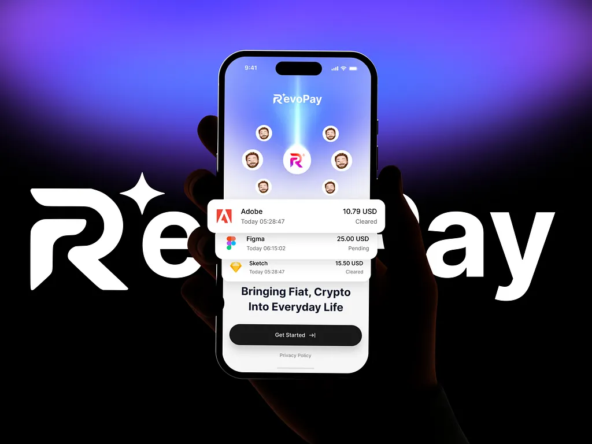

# White wordmark with a sparkle behind a silhouetted hand holding the app, with transaction cards floating out of the screen

**Discipline:** branding · **Design type:** Brand application mockups
**Tags:** logo, fintech, violet, black, wordmark, sparkle, hand-silhouette, floating-cards

## What it is
A black-to-violet glow with a giant white 'RevoPay' wordmark (R with a sparkle) and a dark silhouetted hand holding a phone whose screen shows avatars orbiting the R logo, with Adobe, Figma and Sketch transaction cards floating out over the tagline 'Bringing Fiat, Crypto Into Everyday Life' and a black Get Started button.

## What it means
Bold and modern; the giant logo and popping cards make payments feel alive.

## Techniques
- Put a giant wordmark behind a silhouetted hand.
- Float transaction cards out of the screen.
- Use a violet glow on black.
- Orbit avatars around the logo.

## Best for
- Fintech launch visuals
- Logo-plus-UI presentations
- Dark violet brands

## Vocabulary
- **Giant wordmark backdrop** — A huge logo behind the subject.
- **Floating card** — A UI card popping out of a screen.
- **Avatar orbit** — Profile pictures arranged around a logo.
- **Silhouette hand** — A dark hand outline holding a device.
