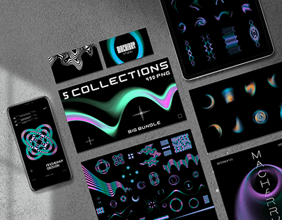

# Iridescent teal-and-pink wave graphics in a five-collection bundle on a concrete desk

**Discipline:** branding ·  · **Design style:** Dark & Neon
**Tags:** assets, graphics, chrome, teal, pink, black, flat-lay, bundle, mockup

## What it is
A top-down grey concrete scene with a phone, a tablet, two cards and posters all showing glowing teal, violet and pink liquid-wave and ornament graphics on black, plus a wide banner '5 COLLECTIONS 490 PNG'.

## What it means
Techy and sleek; neon gradients on black feel like club visuals.

## Techniques
- Display asset packs across many device surfaces.
- Use neon iridescent shapes on black.
- Lay out at angles on a textured surface.
- Label the offering clearly.

## Best for
- Design asset packs and resources
- Digital product listings
- Futuristic graphic sets

## Vocabulary
- **Asset bundle** — A collection of downloadable graphics.
- **Iridescent gradient** — A shifting rainbow-like colour blend.
- **Flat-lay mockup** — Items arranged flat on a surface.
- **Preview grid** — A layout showing samples from a pack.
