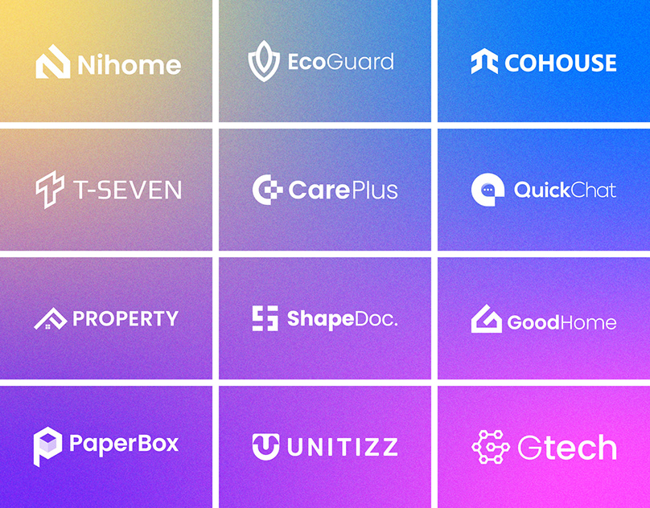

# Twelve white logos on a yellow-to-magenta gradient grid

**Discipline:** branding · **Design type:** Logo collection
**Tags:** logo-collection, gradient, white-logos, grid, tech, monoline, icons

## What it is
A 3x4 grid of cells whose backgrounds blend from yellow through blue and violet to magenta, each with a white logo and wordmark for a different fictional brand (home, eco, chat, docs, tech).

## What it means
Modern, variety-rich and energetic; a shared white treatment and gradient make unrelated logos read as one collection.

## Techniques
- Show logos as white on one continuous gradient split into tiles.
- Pair each icon with a wordmark in clean sans, bold and regular weights.
- Keep the same size and alignment in each cell.
- Use white gutters to make a modular sheet.

## Best for
- Logo portfolios and packs
- Comparing marks for tech and startup brands
- Social covers for logo designers

## Vocabulary
- **Logo sheet** — A grid of logos presented together.
- **Gradient tile** — A cell filled with part of a continuing gradient.
- **Reversed logo** — A logo in white on colour.
- **Icon-plus-wordmark** — A lockup of symbol and name.
