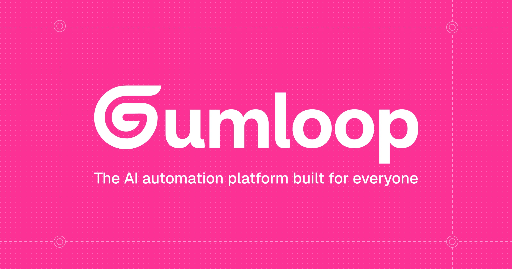

# White wordmark with a spiral G on hot pink, dot grid and dashed guides with target circles

**Discipline:** branding ·  · **Design style:** Playful & Illustrated
**Tags:** wordmark, spiral, hot-pink, white, dot-grid, guides, ai, tagline

## What it is
A hot pink field with a faint dot grid, dashed guide lines ending in target circles at the corners, a heavy white wordmark 'Gumloop' where the G curls into a spiral, and a tagline 'The AI automation platform built for everyone'.

## What it means
Friendly and bold; a looping G says automation and pink says approachable.

## Techniques
- Turn one letter into a spiral.
- Add construction guides as decoration.
- Use white on a single hot pink.
- Add a dot grid texture.

## Best for
- AI and automation brands
- Spiral or loop marks
- Bold single-colour identities

## Vocabulary
- **Spiral letter** — A letter drawn as a coil.
- **Guide decoration** — Design guide lines used as graphics.
- **Target circle** — A small ring marking a corner.
- **Dot grid** — A faint pattern of evenly spaced dots.
