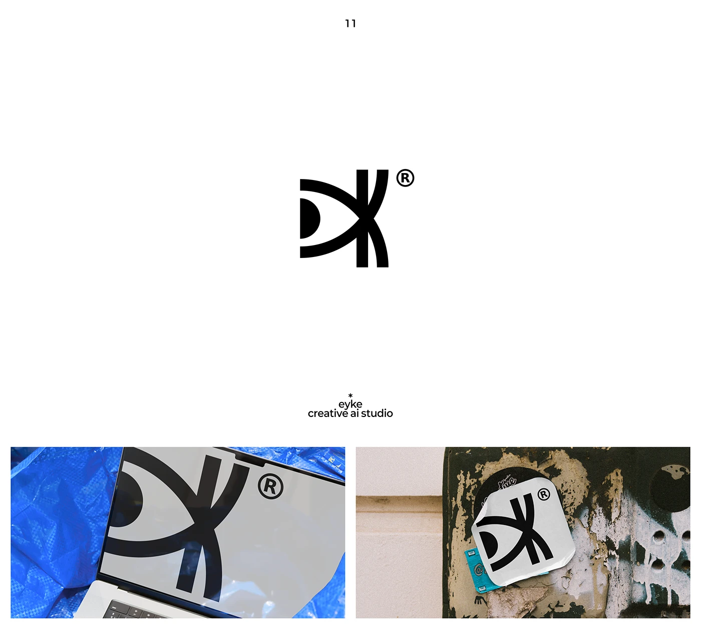

# Bold eye-and-K monogram with a registered mark, shown on a laptop over blue tarp and as a peeling street sticker

**Discipline:** branding ·  · **Design style:** Playful & Illustrated
**Tags:** logo, monogram, eye, black-and-white, ai-studio, sticker, laptop, street

## What it is
A white slide with corner captions and a black symbol of a half-circle pupil inside two arcs merging with vertical bars to form a K, with a ® mark, above two photos: the mark enlarged on a laptop screen on blue plastic, and a white peeling sticker on a graffiti-scarred wall.

## What it means
Sharp and watchful; an eye hidden in a letter suits a creative AI studio.

## Techniques
- Hide an eye inside a letter.
- Crop the mark large on a device.
- Show as a sticker in gritty context.
- Keep pure black on white.

## Best for
- AI and creative studios
- Monograms with a hidden symbol
- Street-art sticker application

## Vocabulary
- **Hidden eye** — An eye shape concealed in a letter.
- **Registered mark** — The circled R symbol beside a logo.
- **Sticker in context** — A logo sticker shown on a real wall.
- **Crop mockup** — A logo shown very large on a device.
