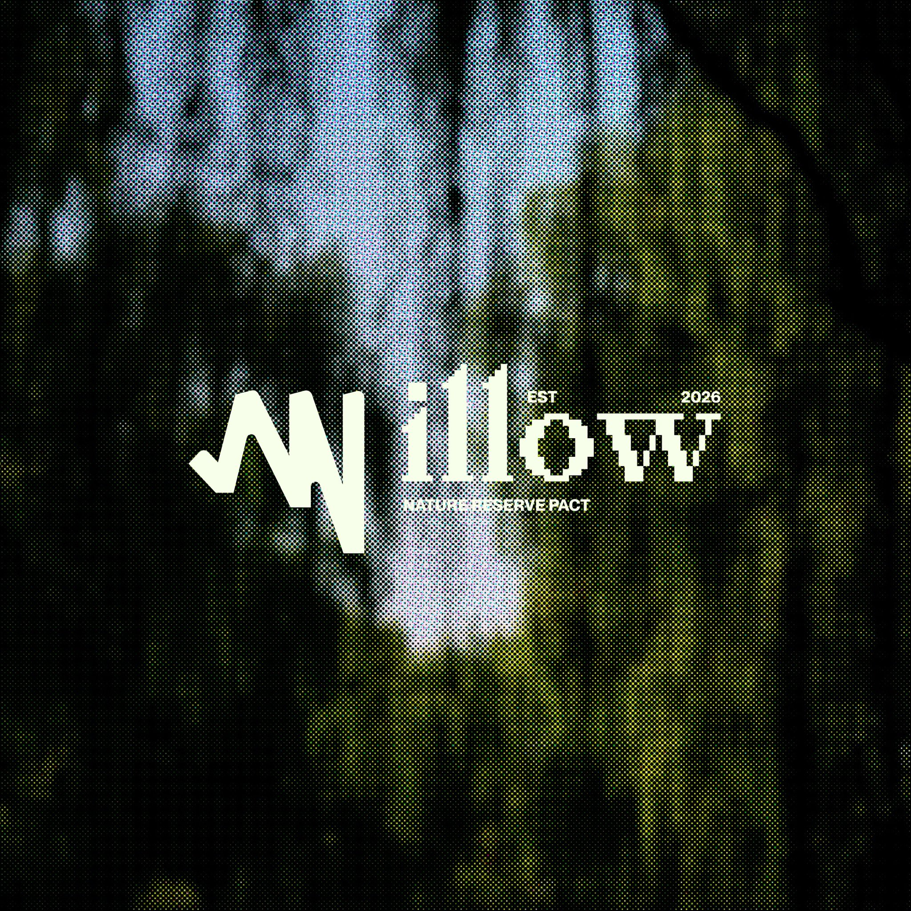

# Pixel-serif wordmark over halftone forest

**Discipline:** branding · **Design type:** Wordmarks
**Tags:** wordmark, halftone, pixel-type, hybrid-type, nature, dark, texture, monogram, square-format

## What it is
A square brand cover for a fictional nature reserve pact called Willow. A cream wordmark sits centred over a heavily blurred forest photograph converted to a coarse coloured halftone (blue, green, black). The 'W' is a jagged, hand-cut zig-zag glyph, and the rest of the word is set in a chunky pixelated serif. Tiny caps text ('EST 2026', 'NATURE RESERVE PACT') is tucked around the mark.

## What it means
It blends the organic with the digital: a forest seen through a screen. The mood is moody, underground and campaigning rather than soft-eco. The blur keeps it atmospheric, while the pixel serif and lightning-bolt W feel like a movement or a collective.

## Techniques
- Mix two unrelated letter styles in one word: a sharp hand-cut monogram glyph plus a pixel-serif for the rest.
- Convert a soft blurry photo to a coarse coloured halftone so it becomes a texture and gives print-era grit to a digital brand.
- Keep the mark as one flat cream colour against a dark, low-key image so it always reads.
- Let the wordmark sit on the image without a box, using contrast alone to separate them.
- Add tiny uppercase metadata (year, descriptor) as micro-typography that makes the lockup feel like a label or stamp.
- Blur the source photo heavily so it stays abstract and no subject competes with the mark.
- Apply a limited cool-green-blue palette with a warm cream highlight for a single tonal story.

## Best for
- Environmental, cultural or activist organisations that want edge
- Music, festival, zine or collective identities
- Brands that bridge nature and technology
- Social profile images and campaign covers that need instant texture

## Vocabulary
- **Halftone** — An image rendered as a grid of dots of varying size or colour, imitating print reproduction.
- **Pixel serif** — A serif typeface built on a visible pixel grid, mixing classic proportions with digital roughness.
- **Hybrid wordmark** — A wordmark whose letters come from different styles or a custom glyph combined with a stock typeface.
- **Monogram glyph** — A single initial drawn as a distinctive symbol, used as the anchor of the logo.
- **Micro-typography** — Very small supporting text, such as dates or descriptors, set around a logo as detail.
- **Low-key image** — A predominantly dark photograph that lets light-coloured elements stand out.
