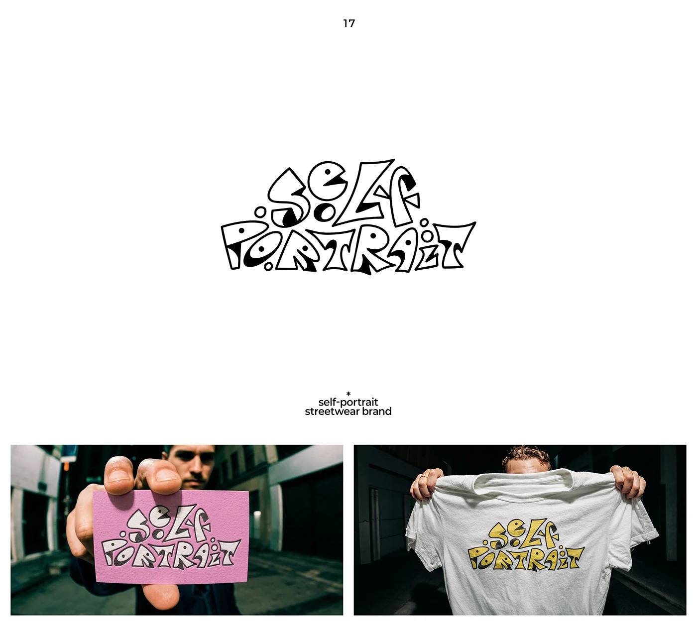

# Outlined bubbly hand-drawn SELF PORTRAIT wordmark, black-filled and yellow versions on a pink card and white tee

**Discipline:** branding ·  · **Design style:** Neo-Brutalist
**Tags:** wordmark, hand-drawn, streetwear, outline, pink, yellow, business-card, apparel

## What it is
A white slide with corner labels and a wobbly hand-drawn wordmark 'self portrait' with irregular letters, black blob fills and dot eyes, then two photos: a pink business card held up to the camera and a white tee held over the face with the mark printed in yellow and black.

## What it means
Playful and raw; imperfect lettering feels like doodled graffiti for a street brand.

## Techniques
- Draw irregular bubbly letters with black blobs.
- Add dot eyes for personality.
- Print in yellow on a tee.
- Use a bright pink card stock.

## Best for
- Streetwear and youth brands
- Hand-drawn wordmarks
- Merch and card applications

## Vocabulary
- **Doodle lettering** — Hand-drawn, irregular letterforms.
- **Blob fill** — Solid black shapes inside outlined letters.
- **Colourway variation** — The same mark in different colours.
- **Held-up mockup** — A product held toward the camera.
