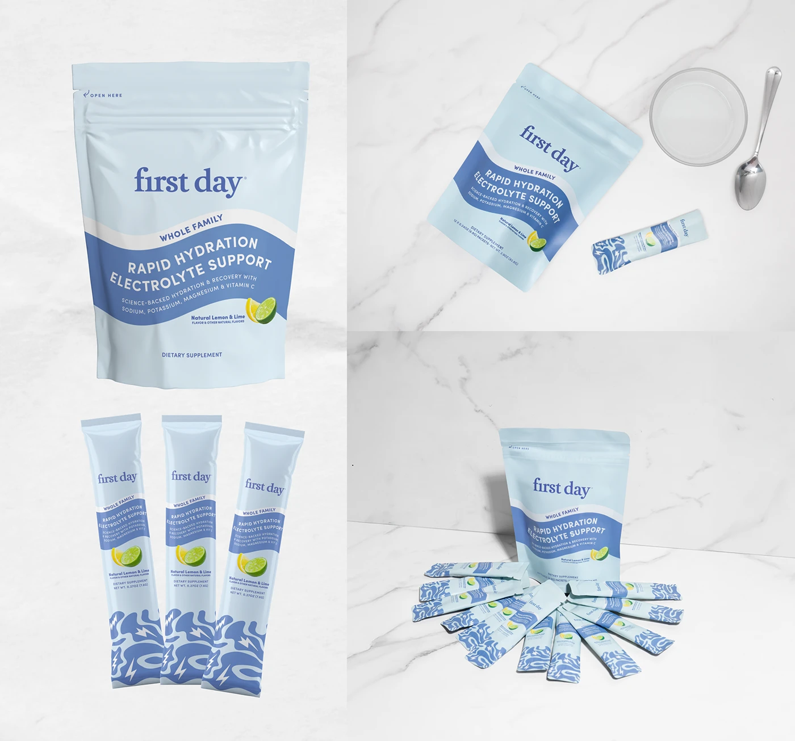

# Pale blue electrolyte pouch and stick packs with a wavy royal-blue band and squiggle pattern on white marble

**Discipline:** branding ·  · **Design style:** Editorial
**Tags:** packaging, pouch, stick-pack, blue, marble, wavy-band, lemon-lime, serif-logo

## What it is
Four marble-backed views of a pale blue pouch with a serif 'first day' logo and a tilted wavy royal-blue band with white type 'RAPID HYDRATION ELECTROLYTE SUPPORT' and a lemon-lime image, three long stick packs with a blue squiggle pattern with lightning bolts, a pouch beside a glass and spoon, and a fan of packs around the pouch.

## What it means
Fresh and clean; a wave band and squiggle pattern say hydration and energy.

## Techniques
- Use a tilted wave band to hold text.
- Repeat a squiggle and bolt pattern on stick packs.
- Show pouch, sticks and use context.
- Style on white marble.

## Best for
- Supplement and drink-mix packaging
- Family wellness brands
- Pouch and stick pack systems

## Vocabulary
- **Wave band** — A tilted wavy strip carrying pack text.
- **Stick pack** — A single-serve long packet.
- **Squiggle pattern** — A wavy line pattern with icons.
- **Marble backdrop** — White veined stone as a photo surface.
