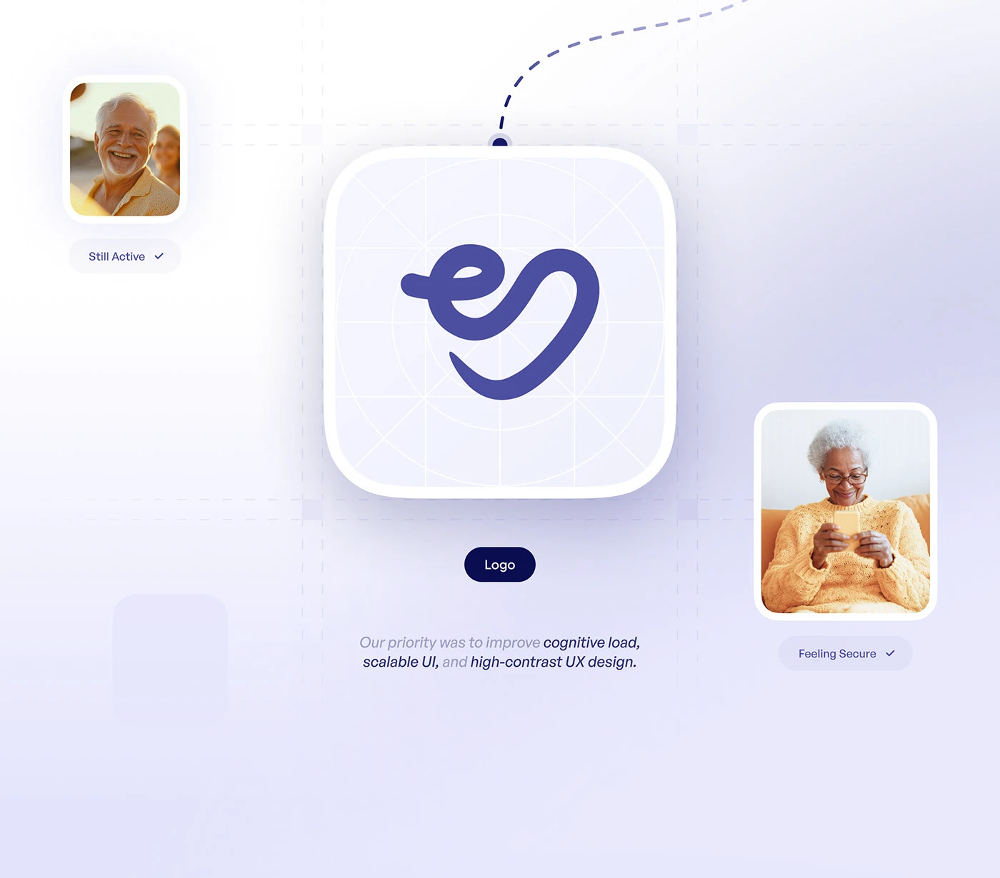

# Indigo Squiggle Icon on Construction Grid

**Discipline:** branding ·  · **Design style:** Warm & Organic
**Tags:** logo, app-icon, construction-grid, indigo, lavender, photo-cards, dashed-line

## What it is
A lavender page with a large white app-icon tile holding an indigo looping squiggle mark on a faint construction grid of circles and diagonals, a dashed line hanging from the top, a Logo pill, two rounded photo cards of older adults labelled Still Active and Feeling Secure, and a priorities sentence.

## What it means
Showing the icon's grid proves craft, and warm photo cards give the mark human meaning.

## Techniques
- Icon on a construction grid overlay
- Single-stroke looping mark
- Dashed line hanging into the composition
- Photo cards with pill labels
- Italic sentence with dark and light phrases

## Best for
- App icon and logo presentations
- Care and wellness brands
- Explaining logo construction

## Vocabulary
- **Construction overlay** — Grid lines and circles showing how an icon was built.
- **App icon tile** — A rounded square holding a logo for a home screen.
- **Feeling pill** — A label naming an emotion a photo represents.
