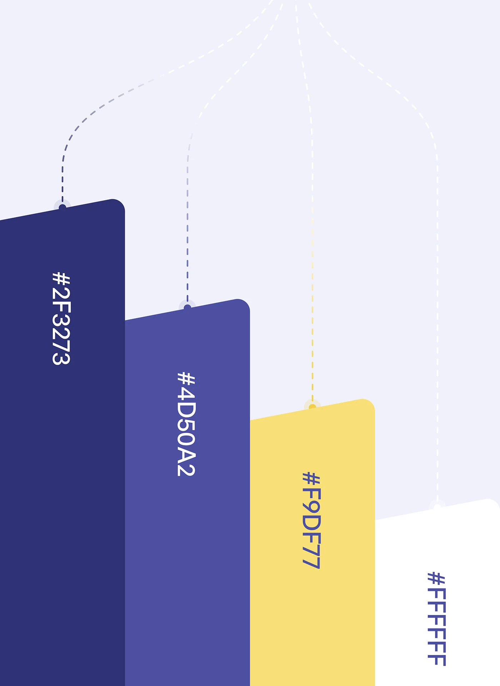

# Indigo and Yellow Hanging Colour Tags

**Discipline:** branding · **Design type:** Colour palette
**Tags:** palette, indigo, yellow, white, dashed-lines, tilted, vertical-type

## What it is
A pale lavender canvas with four tilted, stepped colour tabs (deep indigo, periwinkle, warm yellow, white) hanging from dashed curved lines converging at the top, each tab labelled with a vertical hex code.

## What it means
Dashed strings make the swatches look like hanging tags, and the descending heights create a graphic skyline of colour.

## Techniques
- Swatches suspended from converging dashed lines
- Descending stagger of tab heights
- Hex codes rotated 90 degrees down each tab
- Text colour chosen per swatch for contrast
- Slight tilt of tab tops for movement

## Best for
- Brand palette slides
- Playful identity documentation
- Vertical or mobile-formatted presentation pages

## Vocabulary
- **Hanging swatch** — A colour sample drawn as if suspended by a line.
- **Vertical label** — Text rotated to read top to bottom.
- **Colour skyline** — Swatches of different heights forming a silhouette.
