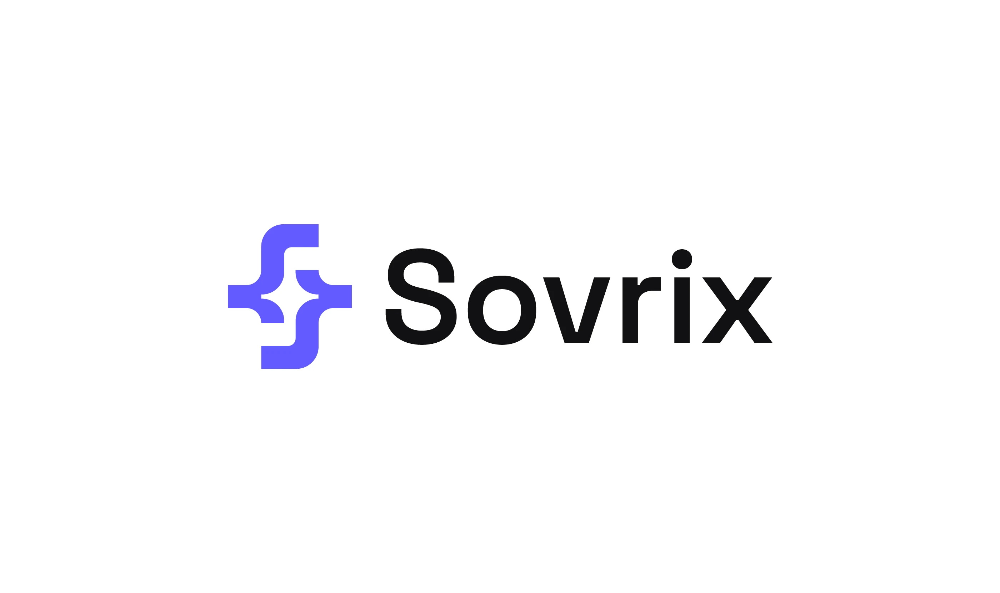

# Violet interlocking S-shaped symbol from rounded pipes beside a bold sans wordmark

**Discipline:** branding ·  · **Design style:** Minimalist
**Tags:** logo, symbol, violet, black, rounded-geometry, tech, wordmark, white-background

## What it is
A white slide with a violet symbol made of two rounded L-shaped pipes forming an S with cross-shaped negative space, next to a black bold grotesque wordmark 'Sovrix'.

## What it means
Clean and technical; rounded joins make it friendly and the negative cross hints at connection.

## Techniques
- Build an initial from rounded pipe segments.
- Leave negative space forming a plus or cross.
- Pair a coloured symbol with a black wordmark.
- Match the wordmark's roundness to the symbol.

## Best for
- Software and infrastructure brands
- Initial-based symbols
- Simple two-colour marks

## Vocabulary
- **Pipe construction** — Forms built from constant-width rounded segments.
- **Negative-space cross** — A plus shape formed by gaps.
- **Horizontal lockup** — Symbol and name side by side.
- **Rounded join** — A curved corner where segments meet.
