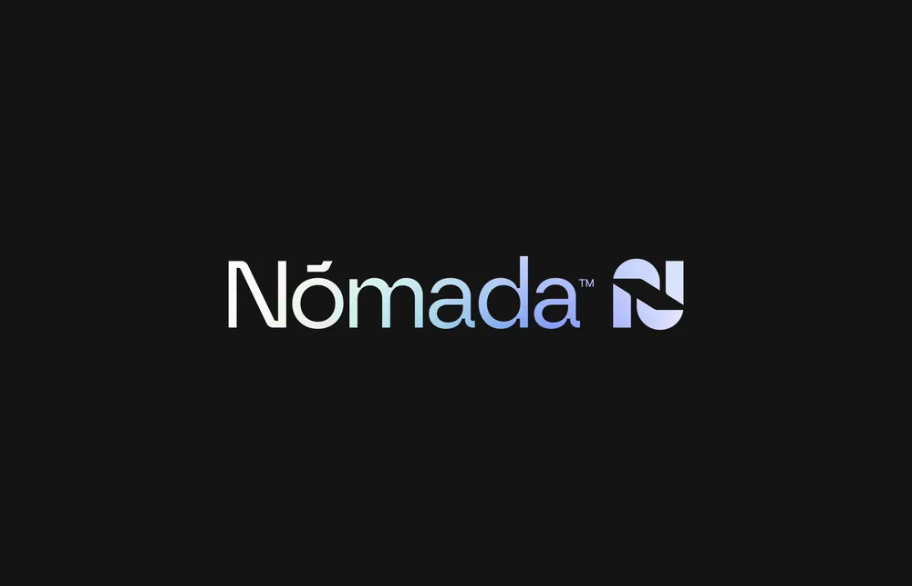

# Wordmark 'Nómada' fading from white through aqua to lilac with a matching N monogram on near-black

**Discipline:** branding · **Design type:** Wordmarks
**Tags:** wordmark, gradient, iridescent, dark, monogram, lilac, aqua, tech

## What it is
A near-black slide with a light geometric sans 'Nómada' whose letters shift from white to aqua to periwinkle, a small ™ and a rounded square monogram of an N made of two shapes in the same gradient.

## What it means
Modern and airy; the gradient makes a wordmark feel like light moving across it.

## Techniques
- Apply a single left-to-right gradient across the letters.
- Add an accent on the o.
- Pair with a monogram in the same gradient.
- Present on near-black.

## Best for
- Travel and tech brands
- Gradient wordmarks
- Dark-mode logo presentations

## Vocabulary
- **Iridescent gradient** — A soft shifting blend from white to cool colours.
- **Monogram tile** — A rounded square holding an initial.
- **Light sans** — A thin-weight sans-serif.
- **Accent mark** — A diacritic used as a design detail.
