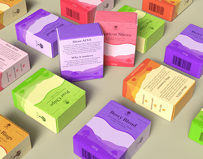

# Isometric scattered soap boxes in purple, lime, pink, orange and yellow with wavy landscape bands

**Discipline:** branding · **Design type:** Packaging and print collateral
**Tags:** packaging, boxes, colourful, wavy-bands, barcode, isometric, flavours, olive-background

## What it is
An isometric field of boxes on an olive backdrop, each with a layered wavy landscape band in a flavour colour (purple berry, green pear, pink apricot, orange, yellow), a small logo, flavour names and back panels with about text and barcodes.

## What it means
Fresh and organised; each flavour has its own colourway on one template.

## Techniques
- Give each flavour a colourway.
- Use layered wavy bands as the graphic.
- Scatter boxes in isometric view.
- Show front and back panels.

## Best for
- Food and soap packaging
- Flavour range systems
- Colourway presentations

## Vocabulary
- **Flavour colourway** — A colour scheme assigned to a variant.
- **Wavy band** — A layered wave graphic on packaging.
- **Isometric scatter** — Objects arranged in angled view.
- **Back panel** — The rear pack side with info and barcode.
