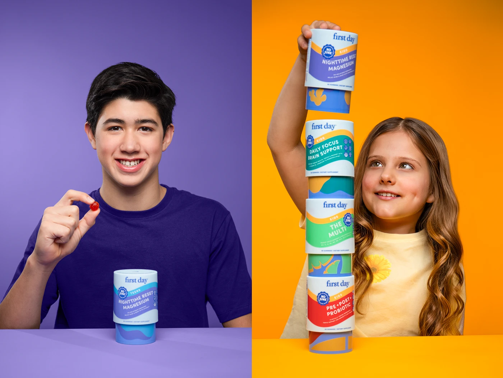

# Split portraits of a teen and a child with packaging on saturated purple and orange

**Discipline:** branding ·  · **Design style:** Photographic & Cinematic
**Tags:** photography, packaging, portrait, purple, orange, stacked-tubs, split-frame, kids

## What it is
A split image: on purple, a smiling teen in a violet tee holds a red gummy beside a tub; on orange, a child stacks four coloured tubs of different flavours into a tall tower and looks up at it.

## What it means
Warm, cheerful and honest; saturated backgrounds match each product line and the tower shows the range as play.

## Techniques
- Colour the whole backdrop to match the product line.
- Use real people with natural expressions.
- Stack packaging into a tower to show the whole range.
- Split the frame into two portraits for contrast.

## Best for
- Family and children's product campaigns
- Range or line presentations
- Packaging launches

## Vocabulary
- **Colour-matched backdrop** — A background tuned to the packaging hue.
- **Range tower** — Product stacked to show the full line.
- **Split portrait** — Two images side by side in one frame.
- **Studio portrait** — A lit photo against a plain backdrop.
