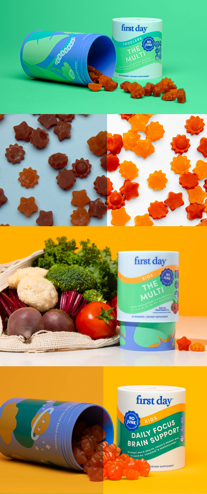

# Playful supplement packaging photographed on saturated colour backgrounds

**Discipline:** branding · **Design type:** Packaging photography
**Tags:** packaging, photography, gummies, green, yellow, blue, kids, flat-lay

## What it is
A vertical stack of product photos: tubs and gummies on emerald green, star- and sun-shaped gummies scattered on blue and white, vegetables beside a tub on mustard, and split-colour shots of tubs pouring gummies. The tubs have wavy blue, mint and orange bands and illustrated planets.

## What it means
Bright, fun and wholesome; strong flat backgrounds and shaped gummies make the packaging pop.

## Techniques
- Place products on single flat colours drawn from the packaging.
- Scatter the product itself (shaped gummies) as pattern.
- Pair products with whole foods to signal real ingredients.
- Split a frame in two colours for graphic contrast.

## Best for
- Kids' and wellness product photography
- DTC packaging launches
- E-commerce hero imagery

## Vocabulary
- **Colour-block backdrop** — A photo background of one flat saturated colour.
- **Flat lay** — Products photographed from above.
- **Wave band** — A flowing curved stripe on packaging.
- **Split frame** — An image divided into two colour halves.
