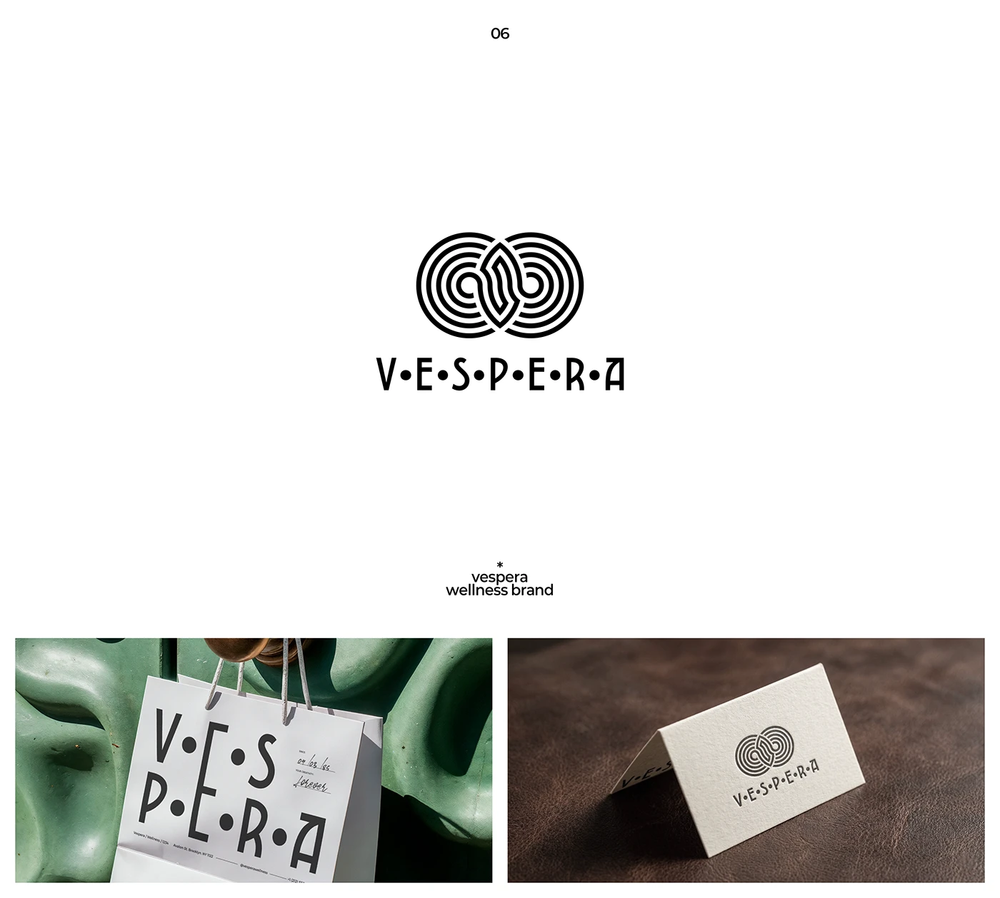

# Labyrinth infinity monogram with dot-spaced wordmark

**Discipline:** branding ·  · **Design style:** 3D & Surreal
**Tags:** logo, monoline, maze, infinity, black-and-white, wellness, stationery, packaging

## What it is
A black-and-white logo: a double circle of concentric maze-like lines forming an infinity shape, above 'V•E•S•P•E•R•A' with dots between letters. Below are applications on a paper bag against sculpted green and a letterpress business card on leather.

## What it means
Meditative, ritual and timeless; the maze suggests a journey inward and the spaced letters feel ceremonial.

## Techniques
- Build a symbol from many parallel monoline strokes to create hypnotic depth.
- Separate wordmark letters with bullets for rhythm and ceremony.
- Design in strict black and white so it suits letterpress and stamping.
- Show physical applications with strong material contrast (paper vs green plaster, leather).

## Best for
- Wellness, spa and ritual brands
- Premium stationery and packaging
- Brands wanting timeless, symbolic marks

## Vocabulary
- **Monoline** — Drawn with strokes of uniform thickness.
- **Interpunct spacing** — Small dots used between letters or words.
- **Labyrinth motif** — A concentric maze pattern suggesting a path.
- **Letterpress** — Printing that presses ink into thick paper.
