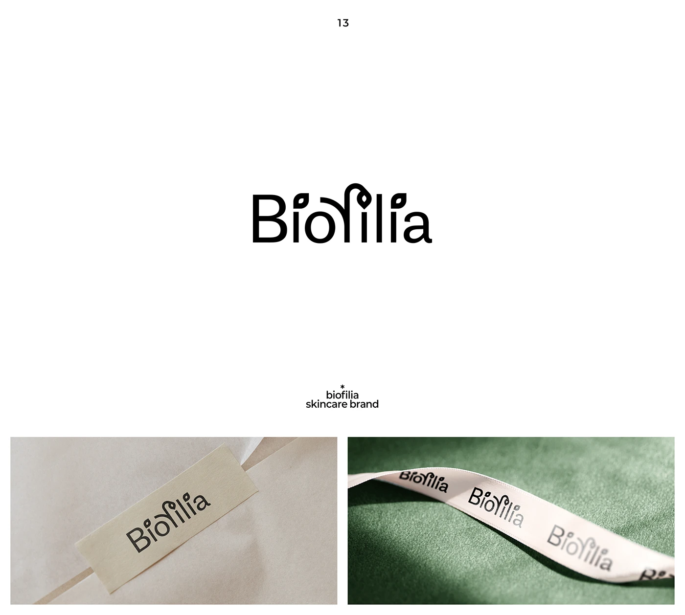

# Skincare wordmark with sprouting leaf detailing on letters, paper label and satin ribbon

**Discipline:** branding ·  · **Design style:** Warm & Organic
**Tags:** wordmark, skincare, leaf, sans-serif, ribbon, paper-label, green, botanical

## What it is
A white slide with a black wordmark 'Biofilia' where the i's dots and the tall l are drawn as small leaves, plus two application photos: a cream paper label on tissue, and a pink satin ribbon printed with the wordmark on a green suede background.

## What it means
Natural, quiet and gentle; leaf details bring life to a rational sans without extra icons.

## Techniques
- Replace letter dots with leaf shapes.
- Grow a stem from one letter to add a botanical flourish.
- Print the wordmark repeatedly on satin ribbon.
- Photograph on a matching muted green fabric.

## Best for
- Skincare and botanical brands
- Wordmarks needing subtle symbolism
- Gift-packaging details

## Vocabulary
- **Leaf tittle** — An i-dot replaced by a leaf.
- **Integrated symbol** — A symbol built into the letterforms.
- **Ribbon print** — A logo repeated on a ribbon.
- **Suede backdrop** — A soft matte fabric surface used in photography.
