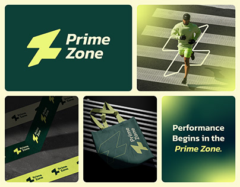

# Forest green and neon lime sports identity with lightning-Z mark

**Discipline:** branding · **Design type:** Brand identity presentation
**Tags:** sports, identity, forest-green, lime, monogram, tote, tape, grid

## What it is
A grid of tiles: the lime lightning-Z symbol and wordmark 'Prime Zone' on deep green, a runner crossing a street with the mark drawn as a white outline, lime branded tape, a green tote with the mark, and a lime-to-green gradient card with the tagline 'Performance Begins in the Prime Zone.'

## What it means
Energetic and disciplined; neon lime on deep green feels like performance gear.

## Techniques
- Use a bold bolt-shaped monogram that can be drawn as a line on photos.
- Pair neon lime with deep forest green.
- Apply the mark to tape and tote for tactile branding.
- Set a tagline with italic emphasis on the key phrase.

## Best for
- Sports and performance brands
- Fitness identity presentations
- Brands using a bold symbol

## Vocabulary
- **Bolt monogram** — A lightning-shaped letter mark.
- **Line overlay** — A logo drawn as an outline over a photo.
- **Branded tape** — Adhesive tape printed with a logo pattern.
- **Italic tagline** — A tagline with an italic key phrase.
